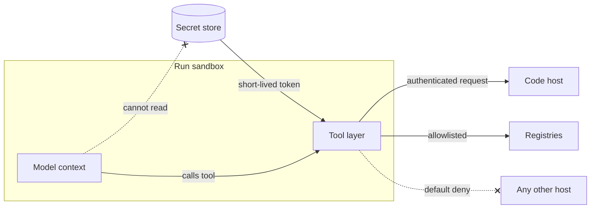

# Secrets and network

> The safest secret is one the model never sees.

## Rules

- **SB-17** Credentials MUST be injected outside the model's context (network-level injection,
  short-lived tokens in the tool layer), never as files or environment variables the agent can
  print.
- **SB-18** Tokens MUST be short-lived and scoped to one repository and the minimum permissions.
- **SB-19** Cloud access from runs MUST use workload identity federation or equivalent. Long-lived
  key files MUST NOT exist.
- **SB-20** Network egress MUST be deny-by-default, with an allowlist (package registries, the code
  host, the memory server).
- **SB-21** If an agent finds a secret in the repository or in output, it MUST stop and report it,
  not use it.

## Diagram

## Sources

[S1] [S7] [R]

## Up

[04. Sandboxes](README.md)
