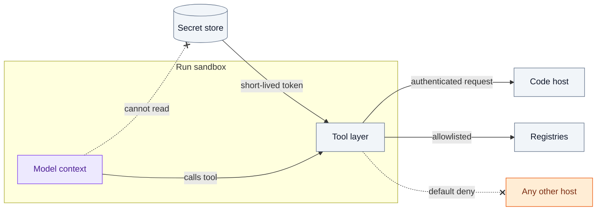

# Secrets and network

> **In short:** the safest secret is one the model never sees. Give the tools short-lived tokens,
> and block every host you haven't listed.

## The problem

If a token sits in a file or an environment variable, the agent can read it. It can print it into
a log, paste it into a comment or send it to another host. It doesn't need bad intent, only a
confused moment.

Open network access makes this worse. A compromised dependency that runs during the tests can
send data anywhere [S7].

## How it works

1. **Inject credentials outside the model's context.** The tool layer holds them, or the network
   layer adds them to requests. The model calls a tool and never sees the token [S1][S7].
2. **Make tokens short-lived and narrow**: one repository, the minimum permissions.
3. **Use workload identity federation** (or an equivalent) for cloud access. The run proves who it
   is, and gets a temporary credential. No long-lived key file exists.
4. **Block the network by default.** Allow only a short list: package registries, the code host,
   the memory server.
5. **Stop on a found secret.** If an agent finds a secret in the repository or in some output, it
   stops and reports it. It doesn't use it.

The diagram shows what the model can reach, and what only the tool layer can.

## Example

The builder for Ana's bug needs to push `factory/issue-412`. It calls the push tool. The tool
layer adds a token that works only for this repository and expires soon. The model never sees it.

While reading the `reports` tests, the builder finds an old API key in a fixture. It doesn't try
the key. It stops and reports it, so a person can revoke it.

> [!WARNING]
> **Secrets in environment variables.** It's the easy setup, and the agent can run `env` and print
> every one of them. Keep credentials in the tool or network layer instead.

## Checklist

- **SB-17** Credentials MUST be injected outside the model's context (network-level injection,
  short-lived tokens in the tool layer), never as files or environment variables the agent can
  print.
- **SB-18** Tokens MUST be short-lived and scoped to one repository and the minimum permissions.
- **SB-19** Cloud access from runs MUST use workload identity federation or an equivalent.
  Long-lived key files MUST NOT exist.
- **SB-20** Network egress MUST be blocked by default, with an allowlist (package registries, the
  code host, the memory server).
- **SB-21** If an agent finds a secret in the repository or in output, it MUST stop and report it,
  not use it.

## Sources

[S1] [S7] [R]

## Up

[04. Sandboxes](README.md)
