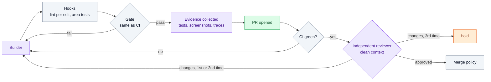

# 05. Verification

> **In short:** reviewing code is turning into reviewing proof: tests that failed and now pass,
> screenshots, videos, traces, and checks that are green or red.

## The problem

Agents write code faster than people can read it. If every change waits for a person to read the
diff, review becomes the bottleneck, and tired reviewers miss things.

The builder's own word doesn't help. "It works" is a claim, not proof. The teams that reached high
autonomy spend most of their agent tokens on verification, not on writing code [S2].

## How it works

The smallest loop that matters is an agent running the software as a user would, and seeing the
result [S2][S9]. Around that loop, every change passes these steps:

1. **Hooks** run fast checks while the builder edits.
2. **The [gate](../reference/glossary.md)**, one deterministic script, must pass before a PR
   exists. CI runs the same script.
3. **The builder attaches [evidence](../reference/glossary.md)** of the type the request's kind
   requires.
4. **CI** runs the gate again on the PR.
5. **An independent reviewer**, an agent with a clean context, checks the PR against the
   acceptance criteria and the product spec.
6. **Requested changes go back to the builder**, a limited number of times. The third request
   puts the job on `hold`.
7. **An approved PR** goes to the [merge policy](../06-merge-policy/README.md).

The diagram shows the path from the builder's first edit to the merge decision.

## Example

The builder fixes Ana's bug on `factory/issue-412`. Hooks lint each edit. The gate passes. The
builder attaches a test that fails on main with "São Paulo" and passes on its branch, with both
outputs.

A reviewer in a fresh session reads the diff, the test output and the acceptance criterion:
"'São Paulo' exports as 'São Paulo'". Once its findings are fixed, it approves, and the PR goes
to the merge policy.

> [!WARNING]
> **Reviewing only the diff.** A reviewer that reads code without the criteria and the evidence
> checks style, not behavior. Give it the proof and the intent first.

## In this section

| Page | Read it to learn |
|---|---|
| [Single gate](single-gate.md) | Why one script defines "passes", everywhere |
| [Evidence artifacts](evidence-artifacts.md) | What proof each kind of work must carry |
| [Hooks](hooks.md) | How to run checks inside the agent's loop |
| [Independent reviewer](independent-reviewer.md) | Which model reviews, with what inputs and output |
| [Return loop](return-loop.md) | How work goes back to the builder, and when to stop |

## Checklist

- **VE-01** One deterministic gate script MUST pass before a PR exists. Hooks, CI and the factory
  MUST run the same script.
- **VE-02** The builder MUST attach evidence to every PR, of the type its request kind requires.
- **VE-03** Every PR MUST be reviewed by an agent that did not write it, in a clean context, before
  any merge decision.
- **VE-04** The reviewer MUST check the PR against the acceptance criteria from triage and the
  product spec, not only against the diff.
- **VE-05** Returns from review to the builder MUST be limited (for example to two rounds). After
  that, the job goes to `hold`.
- **VE-06** Agents SHOULD be able to drive the running application (browser automation, CLI,
  traces), because that is what lets them check their own work.

## Sources

[S2] [S3] [S4] [S7] [S9] [R]

## Up

[Manifesto](../../README.md)
