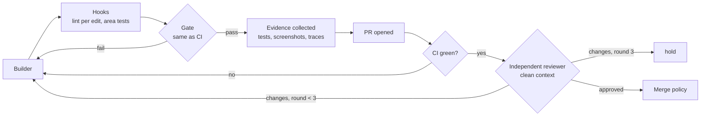

# 05. Verification

> Reviewing code is turning into reviewing proof: tests that failed and now pass, screenshots,
> videos, traces, checks that are green or red.

The teams that reached high autonomy spend most of their agent tokens on verification, not on
writing code [S2]. The smallest loop that matters is an agent running the software as a user would
and seeing the result [S2][S9].

## Rules

- **VE-01** One deterministic gate script MUST pass before a PR exists. Hooks, CI and the factory
  MUST run the same script.
- **VE-02** The builder MUST attach evidence to every PR, of the type its request kind requires.
- **VE-03** Every PR MUST be reviewed by an agent that did not write it, in a clean context, before
  any merge decision.
- **VE-04** The reviewer MUST check the PR against the acceptance criteria from triage and the
  product spec, not only against the diff.
- **VE-05** Review returns to the builder MUST be bounded (for example two rounds), after which the
  job goes to `hold`.
- **VE-06** Agents SHOULD be able to drive the running application (browser automation, CLI,
  traces), because that is what lets them check their own work.

## Diagram

## Sources

[S2] [S3] [S4] [S7] [S9] [R]

## Go deeper

1. [Single gate](single-gate.md): one script, everywhere.
2. [Evidence artifacts](evidence-artifacts.md): what proof each kind of work must carry.
3. [Hooks](hooks.md): checks that run inside the agent's loop.
4. [Independent reviewer](independent-reviewer.md): model choice, context, inputs, output.
5. [Return loop](return-loop.md): sending work back, and when to stop.

## Up

[Manifesto](../../README.md)
