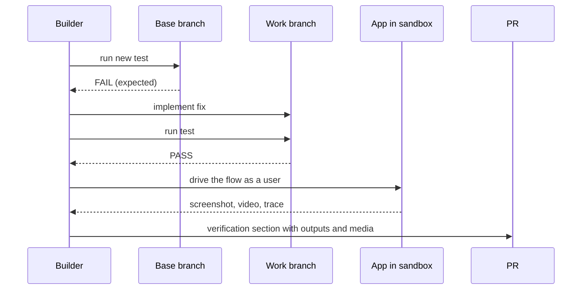

# Evidence artifacts

> "It works" is a claim. A test that failed before and passes now is evidence.

## Rules

- **VE-13** The PR description MUST contain a verification section with the evidence, or links to
  it, organized by acceptance criterion.
- **VE-14** For a bug or incident, the evidence MUST include a test that fails on the base branch
  and passes on the PR branch, with both outputs.
- **VE-15** For a user-visible change, the evidence SHOULD include a screenshot or short video of
  the running application, produced by the agent driving it.
- **VE-16** Evidence MUST be produced by running the software in the sandbox, not described.
- **VE-17** A feature map (the list of user-facing features and how to reach them) and test CLIs
  SHOULD exist so agents share a vocabulary and spend fewer tokens driving the app.
- **VE-18** The share of PRs with evidence SHOULD be tracked.

## Evidence by kind

| Kind | Required | Optional |
|---|---|---|
| `bug` | Reproduction test: fails before, passes after | Screenshot or video if visual |
| `feature` | Criterion → test or artifact checklist | Video of the flow; flag name |
| `incident` | Regression test from the error; root-cause note | Trace or log excerpt |
| `docs` | Diff limited to documentation paths | Rendered preview |
| `refactor` | Existing tests unchanged and green | Benchmark if performance-motivated |
| `chore` | Gate green; release notes linked | Changelog excerpt |

## Diagram

## Sources

[S1] [S2] [S9] [R]

## Up

[05. Verification](README.md)
