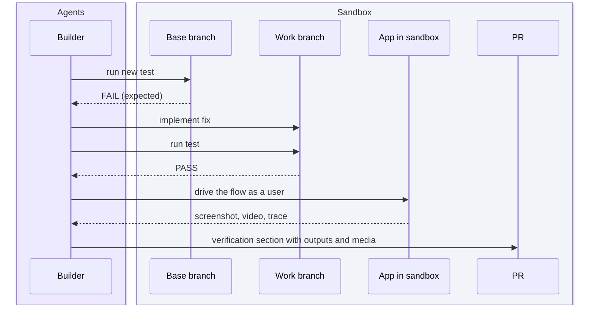

# Evidence artifacts

> **In short:** "it works" is a claim. A test that failed before and passes now is evidence.

## The problem

A PR that says "fixed and tested" asks the reviewer to trust the builder. The reviewer then has
two choices. Trust it, or redo the work to check.

Neither scales. What scales is proof that comes with the PR, made by running the software, and
easy to check in a minute.

## How it works

1. **Write the test first.** For a bug, the builder writes a test that reproduces it and runs it
   on the base branch. It fails, as expected.
2. **Fix, then run the test again** on the work branch. It passes.
3. **Drive the app as a user** in the sandbox, and capture screenshots, video or traces when the
   change is visible.
4. **Add a verification section** to the PR description, organized by acceptance criterion, with
   the outputs and media.

Each [kind](../01-work-intake/request-kinds.md) of request needs its own proof:

| Kind | Required | Optional |
|---|---|---|
| `bug` | Reproduction test: fails before, passes after | Screenshot or video if visual |
| `feature` | Criterion → test or artifact checklist | Video of the flow; flag name |
| `incident` | Regression test from the error; root-cause note | Trace or log excerpt |
| `docs` | Diff limited to documentation paths | Rendered preview |
| `refactor` | Existing tests unchanged and green | Benchmark if performance-motivated |
| `chore` | Gate green; release notes linked | Changelog excerpt |

Two things make this cheaper. A feature map lists the user-facing features and how to reach
them. Test CLIs let an agent drive the app without clicking through it. Both give agents a shared
vocabulary, and both save tokens.

The diagram shows how the builder produces evidence for a bug.

## Example

Ana's request is a `bug`, so the builder needs a reproduction test. It writes a test that exports
a row with "São Paulo". On main, the test fails and the output shows "São Paulo". On
`factory/issue-412`, it passes.

The PR's verification section lists the acceptance criterion, then both test outputs. The builder
also opens the exported file in the sandbox and attaches a screenshot. That part is optional for
a bug, but it helps the reviewer.

> [!WARNING]
> **Describing evidence instead of producing it.** "I ran the tests and they pass" is not
> evidence. Paste the output, or link the artifact the run produced.

## Checklist

- **VE-13** The PR description MUST contain a verification section with the evidence, or links to
  it, organized by acceptance criterion.
- **VE-14** For a bug or incident, the evidence MUST include a test that fails on the base branch
  and passes on the PR branch, with both outputs.
- **VE-15** For a user-visible change, the evidence SHOULD include a screenshot or short video of
  the running application, made by the agent driving it.
- **VE-16** Evidence MUST be produced by running the software in the sandbox, not described.
- **VE-17** A feature map (the list of user-facing features and how to reach them) and test CLIs
  SHOULD exist, so agents share a vocabulary and spend fewer tokens driving the app.
- **VE-18** The share of PRs with evidence SHOULD be tracked.

## Sources

[S1] [S2] [S9] [R]

## Up

[05. Verification](README.md)
