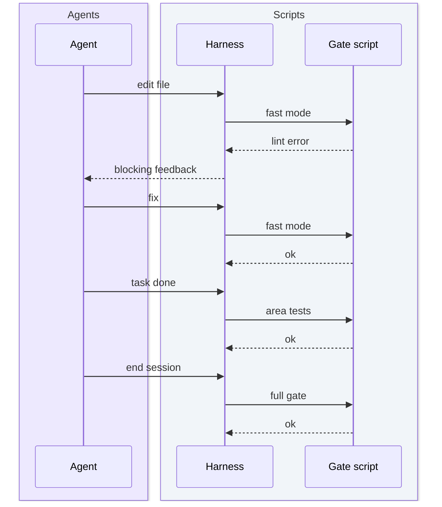

# Hooks

> **In short:** hooks guarantee what a prompt can only ask for. The harness runs the checks, so
> the agent can't forget them.

## The problem

You can tell an agent to run the linter after each change. Sometimes it won't. The problem then
shows up at the end, in the gate, when the agent has moved on and the context is gone.

A hook is a command the agent's harness runs on its own when something happens, such as an edit.
It doesn't depend on the agent remembering.

## How it works

1. **After each edit**, the harness runs the gate in fast mode (lint and format).
2. **When the agent marks a task done**, the harness runs the tests for the affected area.
3. **When the session ends**, the harness runs the full gate.
4. **On failure, the hook sends the agent back.** It exits with the code the harness reads as
   "blocking". In some harnesses that is exit code 2. Other non-zero codes may count only as
   information, so check your harness documentation.
5. **Every hook calls the same [gate script](single-gate.md)**, in fast or full mode. No hook has
   its own list of commands.

The diagram shows a lint error caught and fixed right after the edit.

## Example

The builder for Ana's bug edits the export function. The hook runs the gate in fast mode, and the
formatter complains about one line. The harness hands the error straight back.

The agent fixes the line while the edit is still in front of it. When it marks the task done, the
`reports` tests run and pass.

> [!WARNING]
> **The wrong exit code.** A hook that exits with 1 may look fine. But if your harness treats 1
> as information, the agent never goes back. The hook is silently off.

## Checklist

- **VE-19** The agent harness SHOULD run the fast gate (lint, format) after each edit.
- **VE-20** It SHOULD run the tests for the affected area when the agent marks a task done, and
  the full gate when the session ends.
- **VE-21** A hook that finds a problem MUST exit with the code the harness reads as "send the
  agent back", which differs between harnesses. A wrong exit code silently disables the hook.
- **VE-22** Hooks MUST call the same gate script, in fast or full mode, not a separate set of
  commands.

## Sources

[S3] [S7]

## Up

[05. Verification](README.md)
