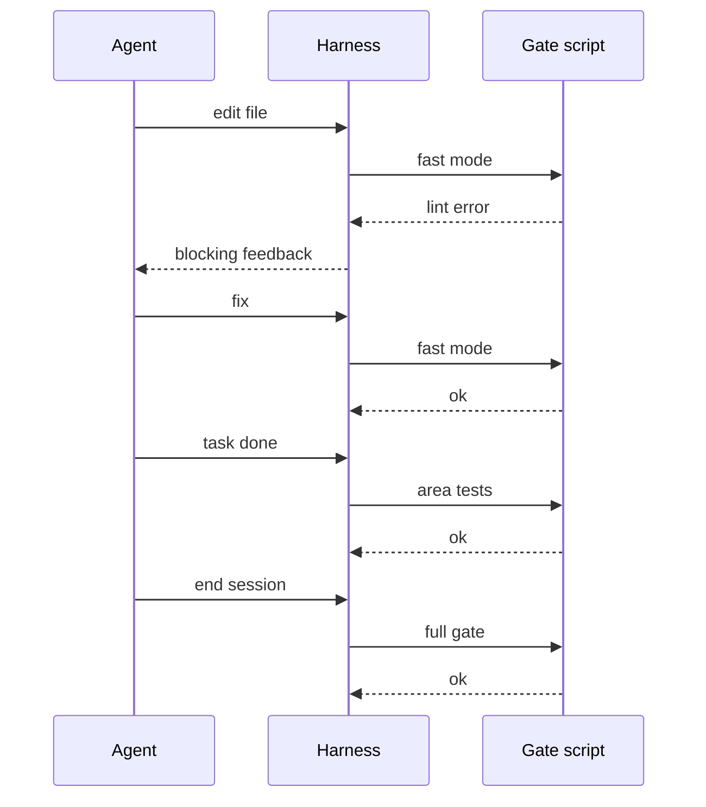

# Hooks

> Hooks guarantee what a prompt can only ask for.

## Rules

- **VE-19** The agent harness SHOULD run the fast gate (lint, format) after each edit.
- **VE-20** It SHOULD run the tests for the affected area when the agent marks a task done, and
  the full gate when the session ends.
- **VE-21** A hook that finds a problem MUST exit with the code the harness interprets as "send the
  agent back" (in some harnesses that is exit code 2; other non-zero codes may be treated as
  informational). Check your harness documentation; a wrong exit code silently disables the hook.
- **VE-22** Hooks MUST call the same gate script, in fast or full mode, not a separate set of
  commands.

## Diagram

## Sources

[S3] [S7]

## Up

[05. Verification](README.md)
