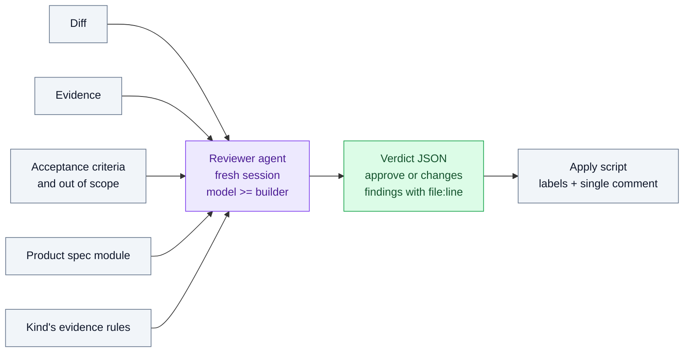

# Independent reviewer

> **In short:** the agent that wrote the code is the worst one to judge it. A separate agent, in
> a fresh session, reviews every PR.

## The problem

A builder that reviews its own work has already convinced itself. It has seen its own reasoning,
so it reads the code the way it meant it, not the way it is.

A weak reviewer is a problem too. It nitpicks valid code, misreads intent and sends work back for
no reason. Each of those loops costs a full round of rework.

## How it works

1. **Start a fresh session.** The [reviewer](../reference/glossary.md) never sees the builder's
   reasoning.
2. **Use a model at least as capable as the builder's.**
3. **Give it the right inputs**: the diff, the evidence, the acceptance criteria and out-of-scope
   list from triage, the relevant product spec, and the evidence rules for the request's kind.
4. **Ask for a structured verdict**: approve or changes, with findings that each cite a file and
   line.
5. **Let a script apply it.** A deterministic script turns the verdict into labels and one
   comment.
6. **Keep the reviewer read-only.** It requests changes. The builder makes them.

The diagram shows the reviewer's inputs and output.

## Example

The reviewer for `factory/issue-412` gets the diff, the test outputs, the acceptance criteria and
the `reports` spec module. The spec says that scheduled reports use the same CSV export.

The diff fixes the manual export but not the scheduled one. The reviewer returns "changes" with
one finding that cites the file and line. A script adds the label and posts one comment. The
reviewer doesn't touch the code.

> [!NOTE]
> The sources disagree on reviewer cost. One tutorial tried a cheap model as reviewer. It
> rejected valid work and made jobs cost more [S3]. A domain-agent advocate argues for small,
> cheap models [S10]. Our position: cheap models for narrow classification, with their own evals.
> A strong model for review.

> [!WARNING]
> **Several models debating.** Setting adversarial models to argue over a PR uses huge token
> budgets and drifts from product intent. One reviewer with the product requirements works better.

## Checklist

- **VE-23** The reviewer MUST run in a fresh session that has not seen the builder's reasoning.
- **VE-24** The reviewer's model MUST be at least as capable as the builder's. A weaker reviewer
  nitpicks valid code, misreads intent and creates costly rework loops.
- **VE-25** The reviewer's inputs MUST be: the diff, the evidence, the acceptance criteria and out
  of scope from triage, the relevant product spec, and the kind's evidence requirements.
- **VE-26** The reviewer MUST return a structured verdict (approve or changes) with findings that
  each cite a file and line, and a deterministic script MUST apply it as labels and one comment.
- **VE-27** One reviewer fed with product requirements SHOULD be preferred over several
  adversarial models arguing, which consume huge token budgets and drift from product intent.
- **VE-28** The reviewer MUST NOT push code. It requests changes, and the builder makes them.

## Sources

[S2] [S3] [S7] [S10] [R]

## Up

[05. Verification](README.md)
