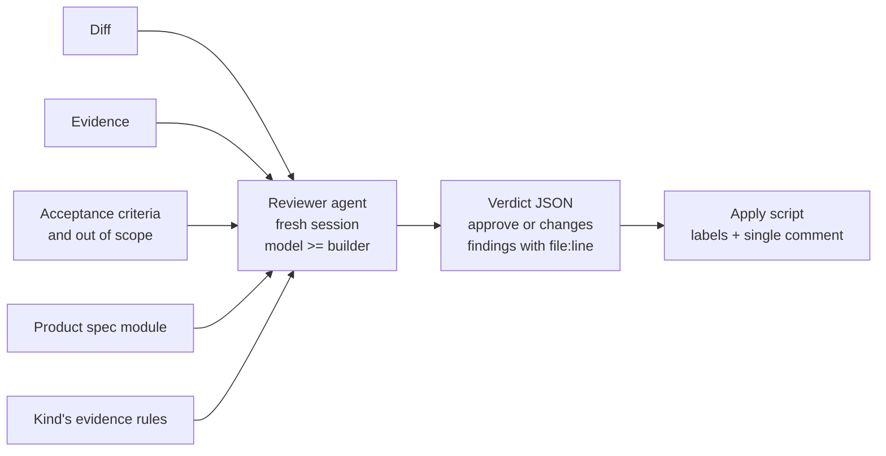

# Independent reviewer

> The agent that wrote the code is the worst one to judge it.

## Rules

- **VE-23** The reviewer MUST run in a fresh session that has not seen the builder's reasoning.
- **VE-24** The reviewer's model MUST be at least as capable as the builder's. A weaker reviewer
  nitpicks valid code, misreads intent and creates costly rework loops.
- **VE-25** The reviewer's inputs MUST be: the diff, the evidence, the acceptance criteria and out
  of scope from triage, the relevant product spec, and the kind's evidence requirements.
- **VE-26** The reviewer MUST return a structured verdict (approve or changes) with findings that
  each cite a file and line, and a deterministic script MUST apply it as labels and one comment.
- **VE-27** One reviewer fed with product requirements SHOULD be preferred over several
  adversarial models arguing. Multi-model debate consumes huge token budgets and drifts from
  product intent.
- **VE-28** The reviewer MUST NOT push code. It requests changes; the builder makes them.

## Diagram

## Where sources disagree

One tutorial tried a cheap model as reviewer and found that it returned valid work and made jobs
cost more [S3]. A domain-agent advocate argues for small cheap models [S10]. Our position: cheap
models for narrow classification with their own evals; a strong model for review.

## Sources

[S2] [S3] [S7] [S10] [R]

## Up

[05. Verification](README.md)
