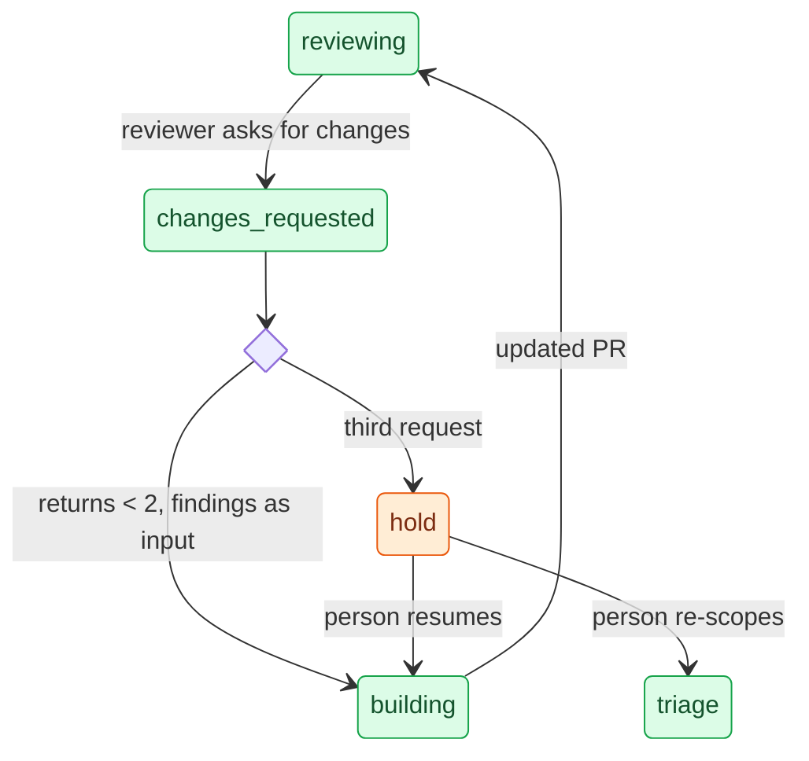

# Return loop

> **In short:** sending work back is good. Sending it back forever is a bill. Count the returns,
> and stop after two.

## The problem

[Back pressure](../reference/glossary.md), the signal that pushes an agent to fix its own work,
is what makes agents good. But a builder and a reviewer can disagree forever. Each round costs a
full build and a full review.

You can't count the rounds in the agent's head, either. Each run starts in a fresh session and
doesn't know how many came before.

## How it works

1. **The reviewer requests changes.** The spine sends the PR back to the builder, with the
   findings as work material.
2. **The builder answers every finding.** It fixes it, or replies why the finding is wrong. It
   never ignores one silently.
3. **The spine counts each return** in a durable place on the PR, such as hidden markers in
   comments.
4. **After two returns, the next request stops the loop.** The job goes to `hold`. The spine
   comments the reason on the PR and notifies the thread where the request came from.
5. **A person decides.** They resume the build, or send the job back to triage to re-scope it.

The diagram shows the states a PR moves through during review.

## Example

On the first review of Ana's fix, the reviewer finds that the scheduled export still loses
accents. The builder fixes it, adds a test for the scheduled export, and the spine records return
one. On the second review, the reviewer approves.

Had the reviewer asked for changes two more times, the third request would have put the job on
`hold`, and Ana would have seen a message in her thread.

> [!WARNING]
> **Counting rounds in memory.** If the count lives in the agent's context, a new session starts
> at zero. The loop never ends. Keep the count on the PR, where every run can read it.

## Checklist

- **VE-29** When the reviewer requests changes, the spine MUST send the PR back to the builder with
  the review findings as work material.
- **VE-30** The number of returns MUST be counted in a durable place attached to the PR (for
  example hidden markers in comments), not in the agent's memory.
- **VE-31** After a fixed number of returns (we use two), the next request for changes MUST put
  the job on `hold`, comment the reason on the PR and notify the origin thread.
- **VE-32** On each return, the builder MUST address the findings or reply why a finding is wrong.
  It MUST NOT silently ignore one.

## Sources

[S3] [S8] [R]

## Up

[05. Verification](README.md)
