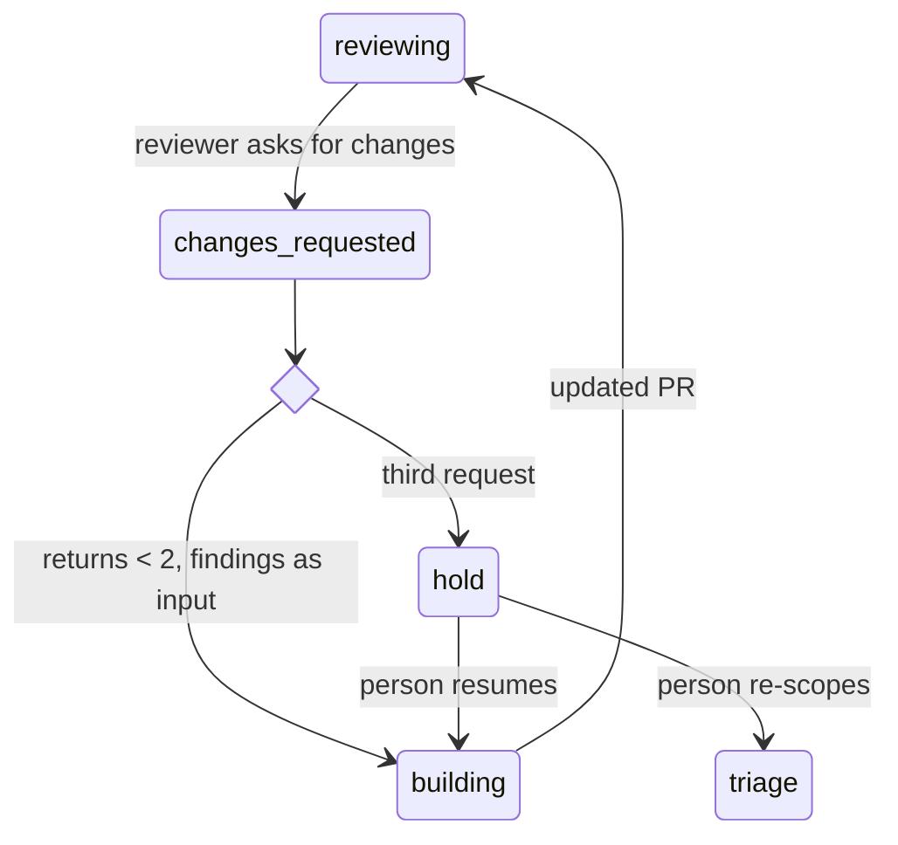

# Return loop

> Back pressure is good. Infinite back pressure is a bill.

## Rules

- **VE-29** When the reviewer requests changes, the spine MUST send the PR back to the builder with
  the review findings as work material.
- **VE-30** The number of returns MUST be counted in a durable place attached to the PR (for
  example hidden markers in comments), not in the agent's memory.
- **VE-31** After a fixed number of returns (we use two), the next request for changes MUST put
  the job on `hold`, comment the reason on the PR and notify the origin thread.
- **VE-32** On each return, the builder MUST address the findings or reply why a finding is wrong.
  It MUST NOT silently ignore one.

## Diagram

## Sources

[S3] [S8] [R]

## Up

[05. Verification](README.md)
