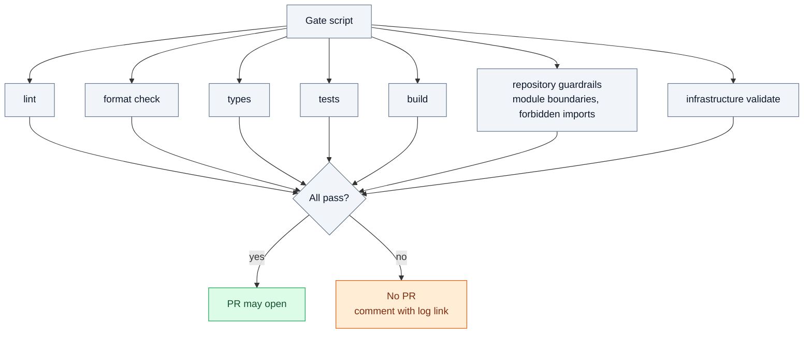

# Single gate

> **In short:** one script is the bar. If it fails, the work doesn't reach review.

## The problem

Hooks, CI and the factory often each keep their own list of checks. Over time the lists drift
apart. A change passes on the agent's machine and fails in CI, or the other way around.

Then people stop trusting the checks. They rerun failed jobs until they turn green, and real
problems slip through with the flaky ones.

## How it works

1. **Write one gate script.** It is the only definition of "passes": lint, format, type check,
   tests, build, repository guardrails and infrastructure validation. A repository guardrail is a
   rule about the codebase itself, such as "no app imports another app".
2. **Make CI run exactly that script**, not its own list of steps.
3. **Add a fast mode** (lint and format only) for the hooks that run inside the agent's loop.
4. **Block the PR while the gate fails.** The factory comments on the tracked item with a link to
   the log instead.
5. **Never switch a rule off to pass.** An agent that needs to work around a rule explains the
   conflict in the PR.
6. **Give flaky tests to a person.** A job that a person owns fixes or quarantines them.

The diagram shows what the gate runs, and what happens when one check fails.

## Example

The builder's first fix for Ana's bug calls `open()` directly in the `reports` module. The gate
fails on the team's lint rule, whose message says to use `write_csv()`. No PR is opened.

The builder switches to `write_csv()` and runs the gate again. Everything passes, and only then
does it open the PR. CI runs the same script and gets the same result.

> [!WARNING]
> **Retrying until green.** If a test fails at random, an agent can rerun the gate until it passes
> by chance. That hides the flaky test, and maybe a real bug. Send it to a person-owned job.

## Checklist

- **VE-07** The repository MUST have exactly one gate script, and it MUST be the only definition
  of "passes": lint, format, type check, tests, build, repository guardrails and infrastructure
  validation.
- **VE-08** CI MUST run exactly that script, not a parallel list of steps.
- **VE-09** The factory MUST NOT open a PR while the gate fails. It comments on the tracked item
  with the log link instead.
- **VE-10** The gate SHOULD offer a fast mode (lint and format only) for inner-loop hooks.
- **VE-11** An agent that needs to work around a rule MUST NOT disable it. It MUST explain the
  conflict in the PR.
- **VE-12** Flaky tests MUST be fixed or quarantined by a job that a person owns. Agents MUST NOT
  retry the gate until it passes by chance.

## Sources

[S2] [S3] [S7] [R]

## Up

[05. Verification](README.md)
