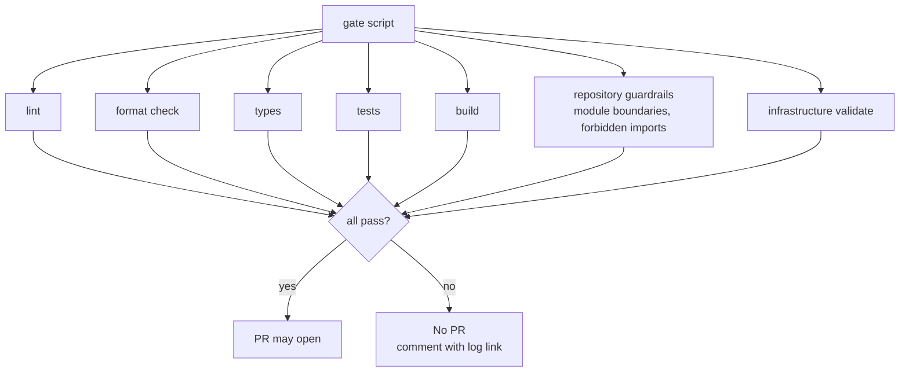

# Single gate

> One script is the bar. If it fails, the work does not reach review.

## Rules

- **VE-07** The repository MUST have exactly one gate script, and it MUST be the only definition
  of "passes": lint, format, type check, tests, build, repository guardrails (for example "no app
  imports another app"), infrastructure validation.
- **VE-08** CI MUST run exactly that script, not a parallel list of steps.
- **VE-09** The factory MUST NOT open a PR while the gate fails. It comments on the tracked item
  with the log link instead.
- **VE-10** The gate SHOULD offer a fast mode (lint and format only) for inner-loop hooks.
- **VE-11** An agent that needs to work around a rule MUST NOT disable it. It MUST explain the
  conflict in the PR.
- **VE-12** Flaky tests MUST be fixed or quarantined by a person-owned job; agents MUST NOT retry
  the gate until it passes by chance.

## Diagram

## Sources

[S2] [S3] [S7] [R]

## Up

[05. Verification](README.md)
