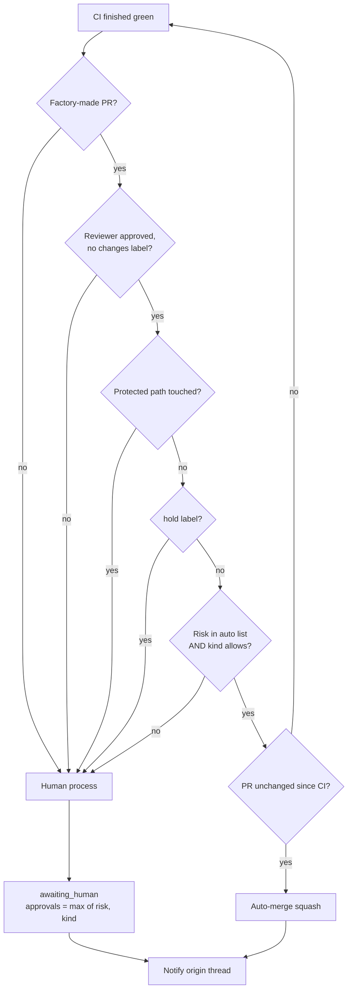

# 06. Merge policy

> Autonomy is a ceiling set by policy, not a feeling. The strictest dimension wins.

## Rules

- **MG-01** A deterministic script MUST make every merge decision from the PR's labels, paths, CI
  status and review verdict. No agent decides to merge.
- **MG-02** Auto-merge MUST require all of: factory-made PR, risk in the auto-merge list, kind that
  allows it, reviewer approval, no protected path, no `hold`, CI green on the latest commit.
- **MG-03** Human approvals MUST scale with risk (for example low 0, medium 1, high 2), and the
  kind's minimum MUST apply when it is higher.
- **MG-04** A PR without a risk label MUST be treated as high risk.
- **MG-05** The factory MUST NOT merge its own PR by any path other than the policy script.
- **MG-06** The reason a PR was not auto-merged MUST be visible on the PR or in the job.
- **MG-07** The merge notice MUST be posted to the origin thread.

## Diagram

## Sources

[S3] [S7] [S9] [R]

## Go deeper

1. [Risk × kind](risk-times-kind.md): the full matrix and how the ceiling is computed.
2. [Human review and hold](human-review-and-hold.md): what people review and how they stop the line.
3. [Incidents](incidents.md): fast to a candidate fix, never merged without a person.

## Up

[Manifesto](../../README.md)
