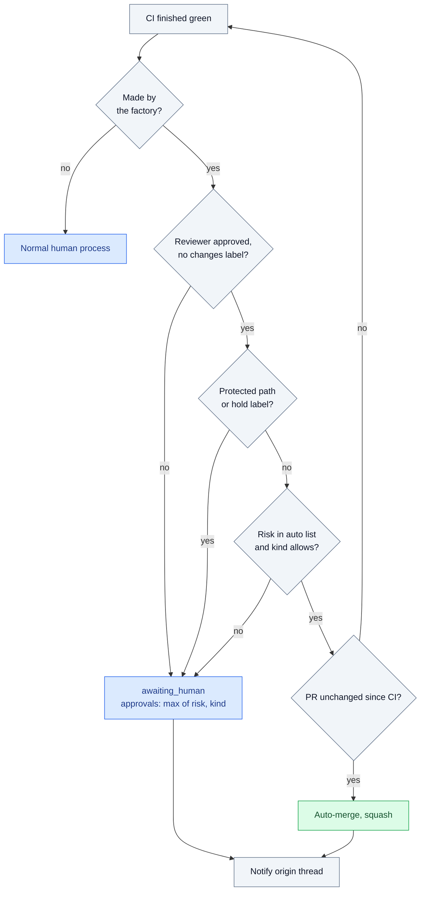

# 06. Merge policy

> **In short:** autonomy is a ceiling set by policy, not a feeling. The strictest dimension wins.

## The problem

Merging is the moment a factory's change reaches everyone. If an agent decides when to merge, the
factory approves its own work. Nothing outside the agent checks that the risk, the kind and the
paths allow it.

If the rule is vague, people can't predict it either. A PR waits, and nobody knows why it didn't
merge or who must act.

## How it works

The merge decision is one deterministic script. It reads the PR's labels, its changed paths, the
CI status, the review verdict and a versioned policy file.

1. **CI finishes green** on the latest commit.
2. **The script checks the PR**: it was made by the factory, the reviewer approved it, and no
   "changes requested" label is set. A PR that people opened follows the team's normal human
   process.
3. **It checks the stops**: no [protected path](../reference/glossary.md) is touched and no
   `hold` label is set.
4. **It checks the ceiling**: the risk is in the auto-merge list, and the kind allows auto-merge.
5. **If every check passes** and the PR hasn't changed since CI ran, the script squash-merges it.
6. **If any check fails**, the job goes to `awaiting_human`. People approve it, as many as the
   stricter of risk and kind requires. The reason is posted on the PR.
7. **The merge notice goes to the origin thread.**

The diagram shows the checks in order. Any failed check sends the PR to people.

## Example

Ana's PR from `factory/issue-412` passes every check. The factory made it and the reviewer
approved it. It touches only the `reports` module and has no `hold` label. Its risk is `low`, its
kind `bug` allows auto-merge, and CI is green on the latest commit. The script squash-merges it and
posts the notice in Ana's thread.

Her later request, "add a date filter to the CSV export", is a `feature`. Features never
auto-merge. The script moves that job to `awaiting_human` and writes the reason on the PR: the
kind `feature` needs at least one person.

> [!IMPORTANT]
> The merge script is the only way a factory PR merges. Agents can't merge their own PRs: the
> harness denies it. See [deny rules](../03-guardrails/deny-rules-and-protected-paths.md).

## In this section

| Page | Read it to learn |
|---|---|
| [Risk × kind](risk-times-kind.md) | The full matrix, and how the ceiling is computed |
| [Human review and hold](human-review-and-hold.md) | What people review, and how they stop the line |
| [Incidents](incidents.md) | Why an incident gets to a candidate fix fast but never merges without a person |

## Checklist

- **MG-01** A deterministic script MUST make every merge decision from the PR's labels, paths, CI
  status and review verdict. No agent decides to merge.
- **MG-02** Auto-merge MUST require all of: factory-made PR, risk in the auto-merge list, kind
  that allows it, reviewer approval, no protected path, no `hold`, CI green on the latest commit.
- **MG-03** Human approvals MUST scale with risk (for example low 0, medium 1, high 2), and the
  kind's minimum MUST apply when it is higher.
- **MG-04** A PR without a risk label MUST be treated as high risk.
- **MG-05** The factory MUST NOT merge its own PR by any path other than the policy script.
- **MG-06** The reason a PR wasn't auto-merged MUST be visible on the PR or in the job.
- **MG-07** The merge notice MUST be posted to the origin thread.

## Sources

[S3] [S7] [S9] [R]

## Up

[Manifesto](../../README.md)
