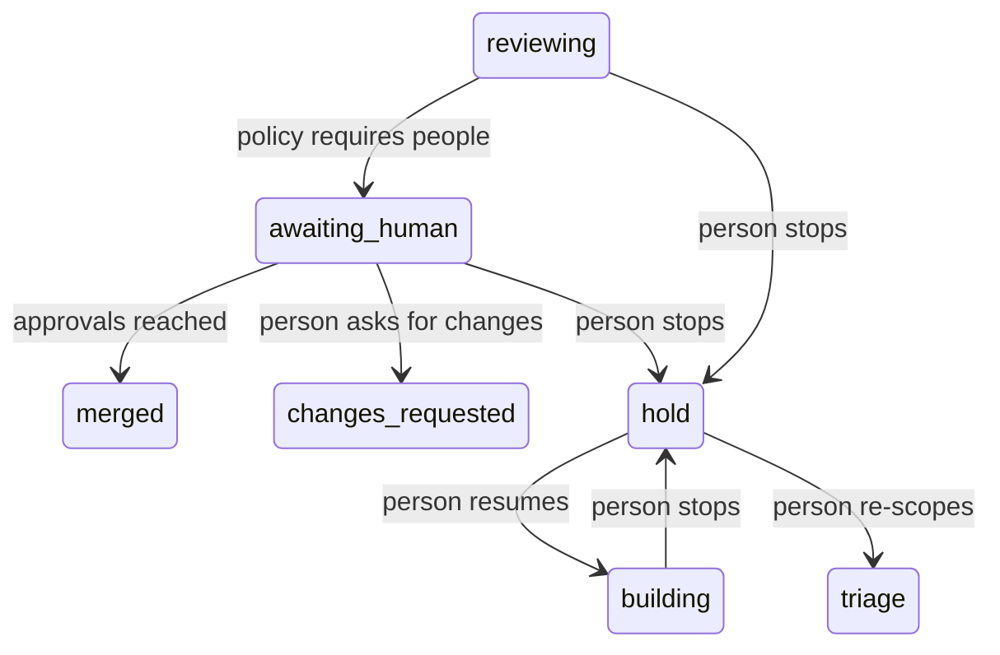

# Human review and hold

> People spend their attention on judgment, and they keep the brake.

## Rules

- **MG-11** Human reviewers SHOULD start from the evidence and the acceptance criteria, then read
  the diff where the evidence is thin.
- **MG-12** Approval SHOULD be possible from where the request started (for example a one-click
  approval in the chat thread that links to the PR).
- **MG-13** Any person with write access MUST be able to put any PR or job on `hold`, and `hold`
  MUST stop every automated action on it.
- **MG-14** User-visible changes SHOULD go through internal dogfooding before general release;
  without it they are never auto-merged.
- **MG-15** Until lint, gate and verification are mature, people SHOULD review every PR, and the
  auto-merge list SHOULD start empty.

## Where sources disagree

One team lets agents merge almost every product PR after investing heavily in its environment
[S2]. Another speaker shows that unsupervised models steadily degrade a codebase over iterative
changes, and argues teams must keep reading the code [S8]. Our position: earn autonomy kind by
kind, starting with docs and refactors, and widen it only when revert and incident rates stay low.

## Diagram

## Sources

[S1] [S2] [S7] [S8] [S9] [R]

## Up

[06. Merge policy](README.md)
