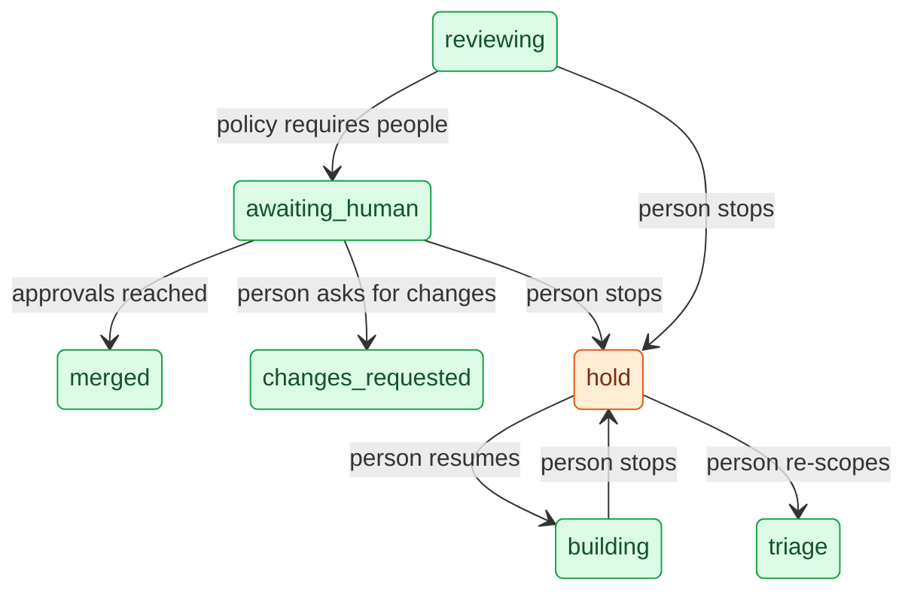

# Human review and hold

> **In short:** people spend their attention on judgment, and they keep the brake.

## The problem

When an agent opens many pull requests, reading every line of every diff becomes the bottleneck.
And a line-by-line read can still miss the real question: does this change do what was asked?

People also need a way to stop the factory. If stopping a bad run takes a code change or a call to
the person who set things up, the run keeps going in the meantime.

## How it works

1. **Start from the evidence.** The reviewer reads the acceptance criteria and the proof first:
   tests, screenshots, traces. Then they read the diff where the evidence is thin.
2. **Approve where the request started.** For example, a one-click approval in the chat thread
   that links to the PR.
3. **Dogfood user-visible changes.** They go through internal dogfooding before general release.
   Without it, they never auto-merge.
4. **Start with people on every PR.** Until lint, the gate and verification are mature, people
   review everything. The auto-merge list starts empty.
5. **Anyone with write access can hold.** Putting a PR or job on [hold](../reference/glossary.md)
   stops every automated action on it. A person later resumes it or sends it back to triage.

The diagram shows where a person can step in.

## Example

Say the factory is new, so the auto-merge list is still empty. Ana's bug fix waits in
`awaiting_human`, even though it is `risk:low`.

A reviewer opens Ana's chat thread and follows the link to the PR. They read the test output
first: it failed with "São Paulo" before the fix and passes after. The evidence is strong, so they
skim the diff and approve with one click in the thread.

If they had spotted a change to an unrelated module, they would put the PR on `hold`. Nothing
would move until a person released it.

> [!NOTE]
> The sources disagree on how much people should read. One team lets agents merge almost every
> product PR, after investing heavily in its environment [S2]. Another speaker shows that
> unsupervised models steadily degrade a codebase over repeated changes, and argues that teams must keep
> reading the code [S8]. Our position: earn autonomy kind by kind, starting with docs and
> refactors. Widen it only while revert and incident rates stay low.

## Checklist

- **MG-11** Human reviewers SHOULD start from the evidence and the acceptance criteria, then read
  the diff where the evidence is thin.
- **MG-12** Approval SHOULD be possible from where the request started (for example a one-click
  approval in the chat thread that links to the PR).
- **MG-13** Any person with write access MUST be able to put any PR or job on `hold`, and `hold`
  MUST stop every automated action on it.
- **MG-14** User-visible changes SHOULD go through internal dogfooding before general release;
  without it they are never auto-merged.
- **MG-15** Until lint, gate and verification are mature, people SHOULD review every PR, and the
  auto-merge list SHOULD start empty.

## Sources

[S1] [S2] [S7] [S8] [S9] [R]

## Up

[06. Merge policy](README.md)
