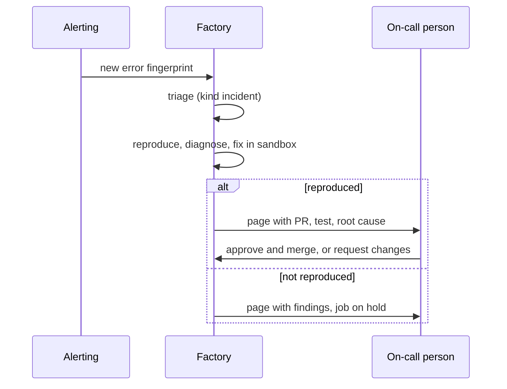

# Incidents

> The page at 3 a.m. should arrive with the pull request the agent thinks fixes it.

## Rules

- **MG-16** Incident jobs MUST never auto-merge, whatever their risk.
- **MG-17** The incident PR MUST include a regression test reproducing the error and a short
  root-cause note.
- **MG-18** Alerts SHOULD create one job per distinct error (deduplicated by fingerprint), labeled
  with their source.
- **MG-19** An incident job that stays in one state longer than a short configured threshold
  SHOULD alert an operations channel.
- **MG-20** When the error cannot be reproduced, the job MUST go to `hold` and the on-call person
  MUST be told, rather than receiving a speculative fix.

## Diagram

## Why

Even if half the candidate fixes are right, on-call work changes from "start investigating" to
"evaluate a proposal" [S8]. No source argues for merging incident fixes without a person.

## Sources

[S8] [R]

## Up

[06. Merge policy](README.md)
