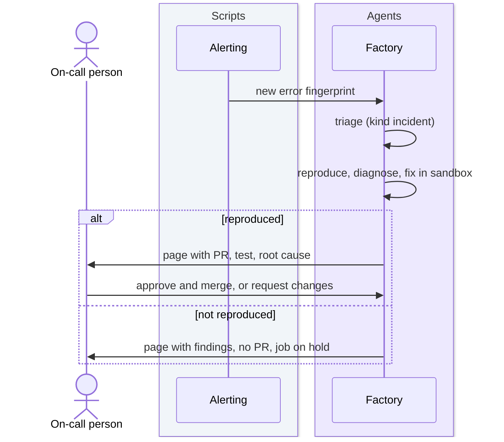

# Incidents

> **In short:** the page at 3 a.m. should arrive with the pull request the agent thinks fixes it.
> The on-call person decides whether it merges.

## The problem

When an alert fires, the on-call person usually starts from nothing. They read the alert, find the
logs, reproduce the error and only then think about a fix.

One speaker says that even if only half the candidate fixes are right, on-call work changes. It
goes from "start investigating" to "evaluate a proposal" [S8]. Speed is the goal, not autonomy.
No source argues for merging incident fixes without a person.

## How it works

An incident is a [kind](../01-work-intake/request-kinds.md) of request: a production error.

1. **Alerting reports a new error.** The factory creates one job per distinct error, deduplicated
   by fingerprint and labeled with its source.
2. **Triage sets the kind `incident`.**
3. **The builder reproduces the error** with a regression test, writes a short root-cause note,
   and fixes the code in its sandbox.
4. **If it reproduced the error**, the factory pages the on-call person with the PR, the test and
   the root cause. The on-call person merges it or asks for changes. Incident jobs never
   auto-merge, whatever their risk.
5. **If it couldn't reproduce the error**, the job goes to `hold` with no PR. The on-call person
   gets the findings instead of a guess.
6. **A stuck incident raises an alert.** A job that stays in one state longer than a short
   threshold, for example 30 minutes, alerts an operations channel.

The diagram shows both outcomes.

## Example

After a release, the error tracker reports a new error: the export endpoint returns 500. Alerting
sends its fingerprint, and the factory opens one incident job, labeled with the alert as its
source. More occurrences of the same error don't create more jobs.

The builder writes a regression test that calls the export endpoint and gets the 500. It writes a
root-cause note, fixes the code, and the test passes. The on-call person gets a page with the PR,
the test and the note. They read the diagnosis, check the test, and merge.

> [!WARNING]
> **A speculative fix.** If the builder can't reproduce the error, a "fix" is a guess. Send the
> findings to on call with no PR, and put the job on `hold` (see `IN-24`).

## Checklist

- **MG-16** Incident jobs MUST never auto-merge, whatever their risk.
- **MG-17** The incident PR MUST include a regression test that reproduces the error and a short
  root-cause note.
- **MG-18** Alerts SHOULD create one job per distinct error (deduplicated by fingerprint),
  labeled with their source.
- **MG-19** An incident job that stays in one state longer than a short configured threshold
  (for example 30 minutes) SHOULD alert an operations channel.
- **MG-20** When the error can't be reproduced, the job MUST go to `hold` with no PR, and the
  on-call person MUST be told, rather than receiving a speculative fix (see `IN-24`).

## Sources

[S8] [R]

## Up

[06. Merge policy](README.md)
