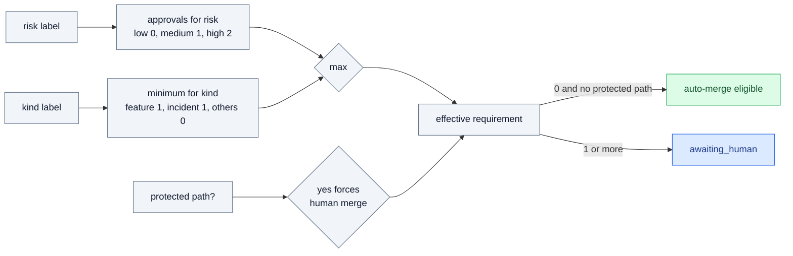

# Risk × kind

> **In short:** two independent dimensions, one rule: the stricter one wins.

## The problem

Risk alone isn't enough. A `feature` can be low risk and still change what users see, so a person
should look at it. Kind alone isn't enough either. A `bug` fix is usually safe to auto-merge, but
not when it is high risk.

And some paths need a person whatever the risk and the kind: CI, the factory's own definition,
infrastructure, auth. Those are the [protected paths](../03-guardrails/deny-rules-and-protected-paths.md).

## How it works

The merge script combines the three rules. All the numbers come from one versioned policy file.

1. **Read the risk label.** It gives the approvals for risk, for example low 0, medium 1, high 2.
2. **Read the kind label.** It gives the minimum for the kind: `feature` 1, `incident` 1, the
   others 0.
3. **Take the larger number.** Required approvals are `max(approvals_for_risk, minimum_for_kind)`.
4. **Check the paths.** If the PR touches a protected path, a person must merge, whatever the
   number says.
5. **Decide.** Auto-merge is possible only when both the risk rule and the kind rule allow it, and
   no protected path is touched. Otherwise the job goes to `awaiting_human`.

The matrix shows the result for every pair, with low 0, medium 1 and high 2 approvals.

| Kind \ Risk | `low` | `medium` | `high` |
|---|---|---|---|
| `docs` | **auto** | 1 person | 2 people |
| `refactor` | **auto** | 1 person | 2 people |
| `chore` | **auto** | 1 person | 2 people |
| `bug` | **auto** | 1 person | 2 people |
| `feature` | 1 person | 1 person | 2 people |
| `incident` | 1 person (on call) | 1 person (on call) | 2 people, one of them on call |
| any kind + protected path | human merge | human merge | human merge |

The diagram shows how the three inputs combine.



The policy file keeps every value in one place. The merge script reads it, so a change to the
policy is a reviewed pull request.

```yaml
merge:
  policy: by-risk
  auto_merge_risks: [risk:low]
  human_reviews: { risk:low: 0, risk:medium: 1, risk:high: 2 }
  kinds:
    feature:  { min_people: 1, auto_merge: false }
    incident: { min_people: 1, auto_merge: false, stuck_after_minutes: 30 }
    bug:      { min_people: 0, auto_merge: true }
    docs:     { min_people: 0, auto_merge: true }
    refactor: { min_people: 0, auto_merge: true }
    chore:    { min_people: 0, auto_merge: true }
  protected_paths:
    - .github/
    - factory/
    - infra/
    - AGENTS.md
    - CLAUDE.md
    - src/auth/        # auth and permission code (adjust to your layout)
```

## Example

Ana's bug has `risk:low`, so the risk rule asks for 0 approvals. The kind `bug` asks for 0 as
well. The larger number is 0, and the PR touches only the `reports` module. It is eligible for
auto-merge.

Now suppose the fix also needed a change to the CI workflow under `.github/`. The numbers stay at
0, but `.github/` is a protected path. A person must merge the PR.

> [!TIP]
> Keep the policy file under a protected path too. Then only a person can widen the factory's
> autonomy.

## Checklist

- **MG-08** Required approvals MUST be `max(approvals_for_risk, minimum_for_kind)`.
- **MG-09** Auto-merge MUST be possible only when both the risk rule and the kind rule allow it,
  and no protected path is touched.
- **MG-10** The policy (approvals per risk, auto-merge risks, minimum per kind, protected paths)
  MUST live in one versioned policy file, read by the merge script.

## Sources

[S7] [S9] [R]

## Up

[06. Merge policy](README.md)
