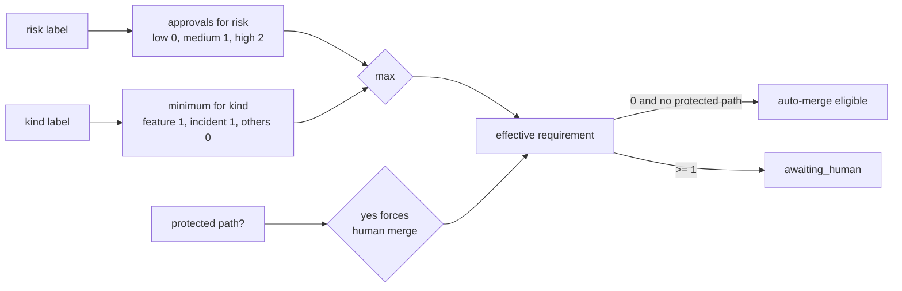

# Risk × kind

> Two independent dimensions, one rule: the stricter one wins.

## Rules

- **MG-08** Effective required approvals MUST be `max(approvals_for_risk, minimum_for_kind)`.
- **MG-09** Auto-merge MUST be possible only when both the risk rule and the kind rule allow it,
  and no protected path is touched.
- **MG-10** The policy (approvals per risk, auto-merge risks, minimum per kind, protected paths)
  MUST live in one versioned policy file, read by the merge script.

## Matrix (with low 0, medium 1, high 2 approvals)

| Kind \ Risk | `low` | `medium` | `high` |
|---|---|---|---|
| `docs` | **auto** | 1 person | 2 people |
| `refactor` | **auto** | 1 person | 2 people |
| `chore` | **auto** | 1 person | 2 people |
| `bug` | **auto** | 1 person | 2 people |
| `feature` | 1 person | 1 person | 2 people |
| `incident` | 1 person (on call) | 1 person (on call) | 2 people |
| any kind + protected path | human merge | human merge | human merge |

## Diagram



## Example policy file

```yaml
merge:
  policy: by-risk
  auto_merge_risks: [risk:low]
  human_reviews: { risk:low: 0, risk:medium: 1, risk:high: 2 }
  kinds:
    feature:  { min_people: 1, auto_merge: false }
    incident: { min_people: 1, auto_merge: false, stuck_after_minutes: 30 }
    bug:      { min_people: 0, auto_merge: true }
    docs:     { min_people: 0, auto_merge: true }
    refactor: { min_people: 0, auto_merge: true }
    chore:    { min_people: 0, auto_merge: true }
  protected_paths:
    - .github/
    - factory/
    - infra/
    - AGENTS.md
    - CLAUDE.md
```

## Sources

[S7] [S9] [R]

## Up

[06. Merge policy](README.md)
