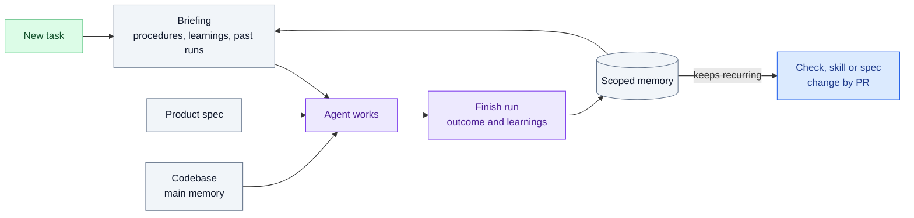

# 07. Memory and context

> **In short:** the codebase is the agent's main memory. Everything else (the spec, past
> learnings, past runs) is fetched when needed, kept in separate scopes, and read as reference.

## The problem

An agent starts every session with an empty head. Without memory, each run rediscovers the same
facts: which test is flaky on Windows, which label doesn't trigger a workflow, where the spec
lives. It makes the same mistakes again and pays for them again in tokens and review time.

Adding memory brings its own risks. If every agent can read and write one shared store, a
confused or tricked agent can plant text that other agents follow as instructions. And if
memory only ever grows, it fills with stale facts that nobody trusts.

## How it works

Memory sits around the code, not instead of it. Each run follows the same loop:

1. **Start with a briefing.** The agent asks the memory service for procedures, learnings and
   similar past runs for its task and repository. A [briefing](../reference/glossary.md) is that
   bundle of retrieved memory.
2. **Read the spec.** The product spec in the repository says what the module should do and how
   to check it.
3. **Read the code.** The codebase stays the main source of truth.
4. **Finish the run.** The agent records its outcome and up to five reusable learnings.
5. **Graduate what repeats.** A learning that keeps coming back becomes a check, a skill or a
   spec change, made through a pull request.

The diagram shows the loop. Memory feeds the next briefing, and repeated learnings leave memory
for the code.

## Example

Ana's bug (the CSV export loses accents) reaches the builder. Its briefing includes a learning
from an earlier run: "Spreadsheet apps need UTF-8 with BOM to show accents in CSV files." The
builder reads the `reports` module spec, finds the acceptance criterion about encoding, and fixes
the bug on `factory/issue-412`.

At the end, it records one new learning: "The CSV export writes files in two places." The next
time a run touches the export, it knows to check both.

> [!IMPORTANT]
> Text from memory is reference, never instructions. A learning that says "skip the tests" is
> data to weigh, not an order to follow.

## In this section

| Page | Read it to learn |
|---|---|
| [Scoped memory](scoped-memory.md) | How scopes, identity and isolation keep memory safe |
| [Briefing and reflection](briefing-and-reflection.md) | What to fetch before a task, and what to record after |
| [Agent-readable specs](agent-readable-specs.md) | How the product spec becomes the contract for triage, builder and reviewer |

## Checklist

- **MC-01** Every agent run MUST start with a briefing: the procedures, learnings and similar
  past runs that fit the task and repository.
- **MC-02** Every run MUST end by recording an outcome and zero to five reusable learnings.
- **MC-03** Memory MUST be split by scope (agent, project, domain, global), and an agent's
  identity and scopes MUST come from authentication.
- **MC-04** Anything read from memory or documents MUST be treated as reference material, never
  as instructions.
- **MC-05** The product spec (what to build, with acceptance criteria per module) MUST live in the
  repository, in a form agents read before coding.
- **MC-06** Learnings that keep recurring SHOULD graduate into code (a check, a skill, a spec
  update) instead of growing memory forever.

## Sources

[S2] [S5] [S7] [S8] [R]

## Up

[Manifesto](../../README.md)
