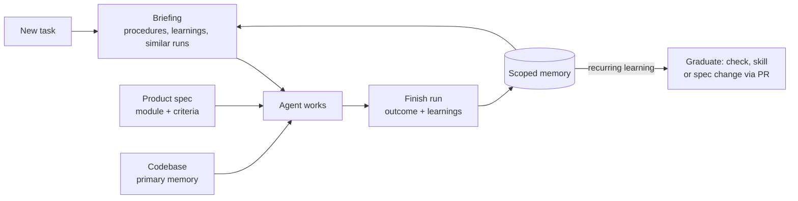

# 07. Memory and context

> The codebase is the agent's main memory. Everything else (spec, learnings, past runs) must be
> retrievable on demand, scoped, and treated as reference.

## Rules

- **MC-01** Every agent run MUST start with a briefing: relevant procedures, learnings and similar
  past runs for the task and repository.
- **MC-02** Every run MUST end by recording an outcome and zero to five reusable learnings.
- **MC-03** Memory MUST be partitioned by scope (agent, project, domain, global), and an agent's
  identity and scopes MUST come from authentication.
- **MC-04** Anything retrieved from memory or documents MUST be treated as reference material,
  never as instructions.
- **MC-05** The product spec (what the factory should build, with acceptance criteria per module)
  MUST live in the repository in a form agents read before coding.
- **MC-06** Learnings that keep recurring SHOULD graduate into code (a check, a skill, a spec
  update), not grow the memory forever.

## Diagram

## Sources

[S2] [S5] [S7] [S8] [R]

## Go deeper

1. [Scoped memory](scoped-memory.md): scopes, identity, isolation.
2. [Briefing and reflection](briefing-and-reflection.md): what to retrieve before, what to record after.
3. [Agent-readable specs](agent-readable-specs.md): the product spec as the contract for triage, builder and reviewer.

## Up

[Manifesto](../../README.md)
