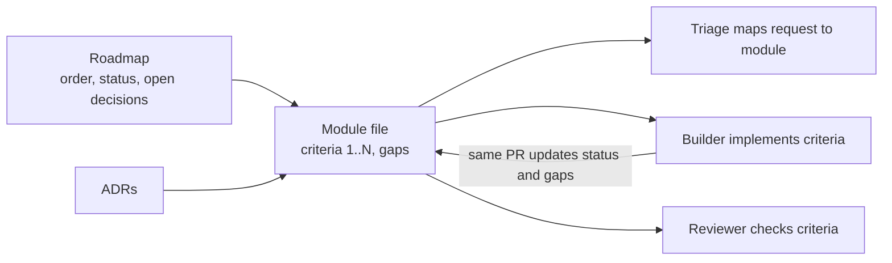

# Agent-readable specs

> The spec is the contract between the person who asks, the builder who delivers and the reviewer
> who checks.

## Rules

- **MC-18** The product spec MUST live in the repository: a roadmap (order, status, open
  decisions) and one file per module with problem, expected result, numbered acceptance criteria,
  out of scope and gaps.
- **MC-19** Acceptance criteria MUST be verifiable by a test or an artifact.
- **MC-20** Triage MUST map each request to a module; the reviewer MUST check the PR against that
  module's criteria.
- **MC-21** A PR that fulfils or changes a criterion MUST update the module's status and gaps in
  the same PR.
- **MC-22** Architecture decisions MUST be recorded as short ADRs next to the spec.
- **MC-23** When a human-facing version of the spec exists elsewhere, the repository version MUST
  be declared the source of truth for agents.
- **MC-24** Diagrams SHOULD be text (Mermaid), so agents can read and update them.

## Diagram



## Module file skeleton

```markdown
# Module N: Name
- Status: planned | in progress | done, with gaps
- Milestone: M2
- Depends on: modules 1, 2

## Problem
## Expected result
## Acceptance criteria
1. ... (verifiable)
## Out of scope
## Gaps
```

## Sources

[S3] [S4] [S8] [R]

## Up

[07. Memory and context](README.md)
