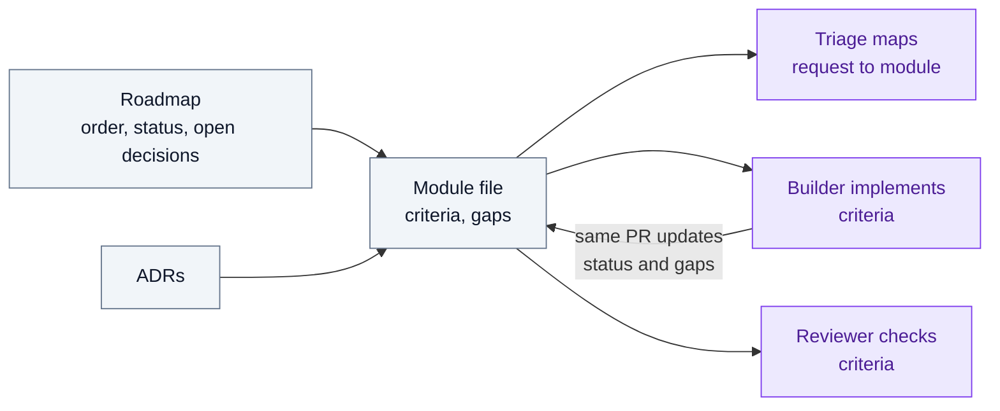

# Agent-readable specs

> **In short:** the spec is the contract between the person who asks, the builder who delivers
> and the reviewer who checks. Keep it in the repository, where all three can read it.

## The problem

Product knowledge often lives in a wiki, a slide deck or someone's head. Agents can't see it. So
triage guesses which module a request touches, the builder guesses what "done" means, and the
reviewer checks the code against nothing.

A spec that agents can read but never update has a second problem. It drifts away from the code,
and after a few months nobody trusts it.

## How it works

The spec is a set of plain files next to the code:

1. **A roadmap** lists the modules in order, with their status and the decisions still open.
2. **One file per module** states the problem, the expected result, numbered acceptance criteria,
   what is out of scope, and known gaps.
3. **Short ADRs** (architecture decision records) sit next to the spec and explain why the system
   is built the way it is.
4. **Triage maps each request to a module.** The builder implements that module's criteria. The
   reviewer checks the PR against the same criteria.
5. **The PR updates the spec.** When a PR fulfils or changes a criterion, it updates the module's
   status and gaps in the same PR.

Each acceptance criterion must be checkable by a test or an artifact. "Exports keep accents" is
checkable. "Exports work well" is not.

Your team may also keep a version of the spec for people, in a wiki or a deck. That is fine, but
say clearly that the repository version is the source of truth for agents.

The diagram shows who reads the module file, and who writes it back.



A module file can be as short as this:

```markdown
# Module N: Name
- Status: planned | in progress | done, with gaps
- Milestone: M2
- Depends on: modules 1, 2

## Problem
## Expected result
## Acceptance criteria
1. ... (verifiable)
## Out of scope
## Gaps
```

## Example

Triage maps Ana's bug to the `reports` module. Its file has a criterion: "Exported CSV files
open in spreadsheet apps with accents intact." There is no test for it, so the module lists it
under gaps.

The builder adds the test and the fix on `factory/issue-412`. In the same PR, it removes the
gap and marks the criterion as covered. The reviewer checks the PR against that criterion, not
against its own idea of what the export should do.

> [!TIP]
> Draw diagrams in text, with Mermaid. Agents can read a Mermaid block and update it in the same
> PR. They can't do that with an image.

## Checklist

- **MC-18** The product spec MUST live in the repository: a roadmap (order, status, open
  decisions) and one file per module with problem, expected result, numbered acceptance
  criteria, out of scope and gaps.
- **MC-19** Acceptance criteria MUST be checkable by a test or an artifact.
- **MC-20** Triage MUST map each request to a module, and the reviewer MUST check the PR against
  that module's criteria.
- **MC-21** A PR that fulfils or changes a criterion MUST update the module's status and gaps in
  the same PR.
- **MC-22** Architecture decisions MUST be recorded as short ADRs next to the spec.
- **MC-23** When a version of the spec for people exists elsewhere, the repository version MUST
  be declared the source of truth for agents.
- **MC-24** Diagrams SHOULD be text (Mermaid), so agents can read and update them.

## Sources

[S3] [S4] [S8] [R]

## Up

[07. Memory and context](README.md)
