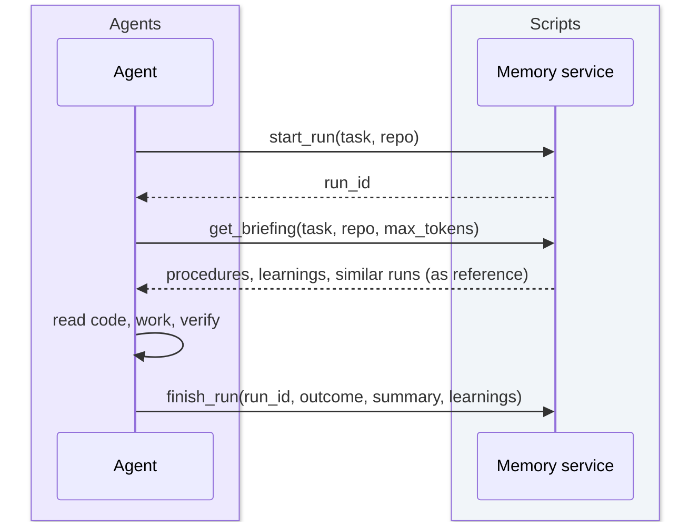

# Briefing and reflection

> **In short:** start each run with what the factory already knows. End it by writing down what
> you learned, in a form the next run can use.

## The problem

Memory is useless if nobody reads it at the right moment. An agent that reads code first and
searches memory later has already made its plan. By then the warning it needed comes too late.

Recording is the other half. If runs write nothing at the end, memory stays empty. If they write
everything, memory fills with status updates like "PR opened" that help nobody.

## How it works

Every run opens and closes with a call to the memory service:

1. **Start the run.** The agent calls `start_run` with the task and repository, and gets a run
   id.
2. **Ask for a briefing.** Before it reads any code, the agent calls `get_briefing` with the task
   description, the repository and a token limit.
3. **Read it as reference.** The service returns procedures (how things are done here), learnings
   (facts earlier runs found) and summaries of similar runs with their outcomes. The text comes
   wrapped and labeled as reference, so the agent doesn't follow instructions hidden in it.
4. **Do the work.** The agent reads code, changes it and checks it.
5. **Reflect and finish.** The agent calls `finish_run` with an outcome, a one-paragraph summary
   and zero to five learnings.

The diagram shows the calls in order.

A learning is one to three sentences that help a future run on a *different* task. The test is
simple: would it still be useful next month, on another issue?

| Good learning | Not a learning |
|---|---|
| "On Windows, test X fails with a file lock; it passes in Linux CI." | "Fixed the bug." |
| "Labels set by the CI token don't trigger workflows; dispatch explicitly." | "The PR was opened." |
| "A bug that can't be reproduced goes to hold, because there is no move from building to needs_info." | "Remember to be careful." |

## Example

The builder for Ana's bug calls `get_briefing` with "CSV export loses accents" and the reports
repository. The briefing contains a procedure for running the export tests, and a similar past
run about Excel and encodings.

The fix works. The builder finishes with outcome `success` and one learning: "The CSV export
writes files in two places: the download endpoint and the scheduled report job." It doesn't
record "fixed issue 412". That is a status update, and the job already holds it.

> [!WARNING]
> **Reading the briefing as orders.** Memory can hold text an attacker planted, or an old
> learning that is now wrong. An agent that obeys it can be steered. Wrap it, label it, and weigh
> it like any other reference.

## Checklist

- **MC-13** The agent MUST ask for the briefing with the task description and repository before
  it reads code, and the briefing MUST have a token limit.
- **MC-14** The briefing SHOULD contain procedures (how things are done here), learnings (facts
  earlier runs found) and summaries of similar runs with their outcomes.
- **MC-15** The briefing MUST be wrapped and labeled as reference material, so the agent doesn't
  follow instructions hidden in it.
- **MC-16** At the end, the run MUST record its outcome (`success`, `partial`, `failure`,
  `aborted`), a one-paragraph summary, and zero to five learnings of one to three sentences each.
- **MC-17** A learning MUST be reusable by a future run on a different task. Status updates and
  task-specific details aren't learnings.

## Sources

[S5] [S7] [R]

## Up

[07. Memory and context](README.md)
