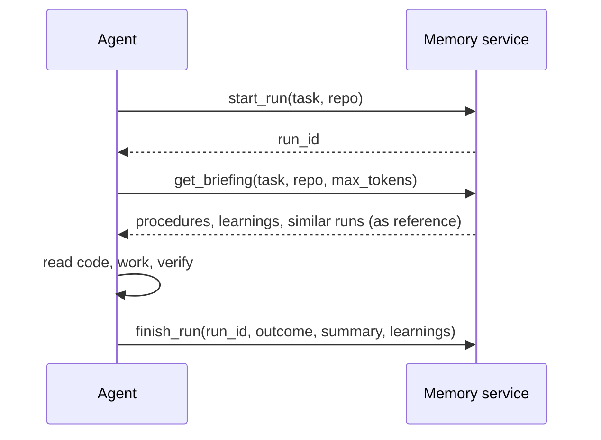

# Briefing and reflection

> Start with what the factory already knows. End by telling it what you learned.

## Rules

- **MC-13** The briefing MUST be requested with the task description and repository, before the
  agent reads code, and MUST be bounded in tokens.
- **MC-14** The briefing SHOULD contain procedures (how things are done here), learnings (facts
  discovered by earlier runs), and summaries of similar runs with their outcomes.
- **MC-15** The briefing MUST be wrapped and labeled as reference material, so the agent does not
  follow instructions embedded in it.
- **MC-16** At the end, the run MUST record its outcome (`success`, `partial`, `failure`,
  `aborted`), a one-paragraph summary, and zero to five learnings of one to three sentences each.
- **MC-17** A learning MUST be reusable by a future run on a different task. Status updates and
  task-specific details are not learnings.

## Diagram

## Good and bad learnings

| Good | Bad |
|---|---|
| "On Windows, test X fails with a file lock; it passes in Linux CI." | "Fixed issue 42." |
| "Labels set by the CI token do not trigger workflows; dispatch explicitly." | "The PR was opened." |
| "A bug not reproduced goes to hold, because there is no building to needs_info." | "Remember to be careful." |

## Sources

[S5] [S7] [R]

## Up

[07. Memory and context](README.md)
