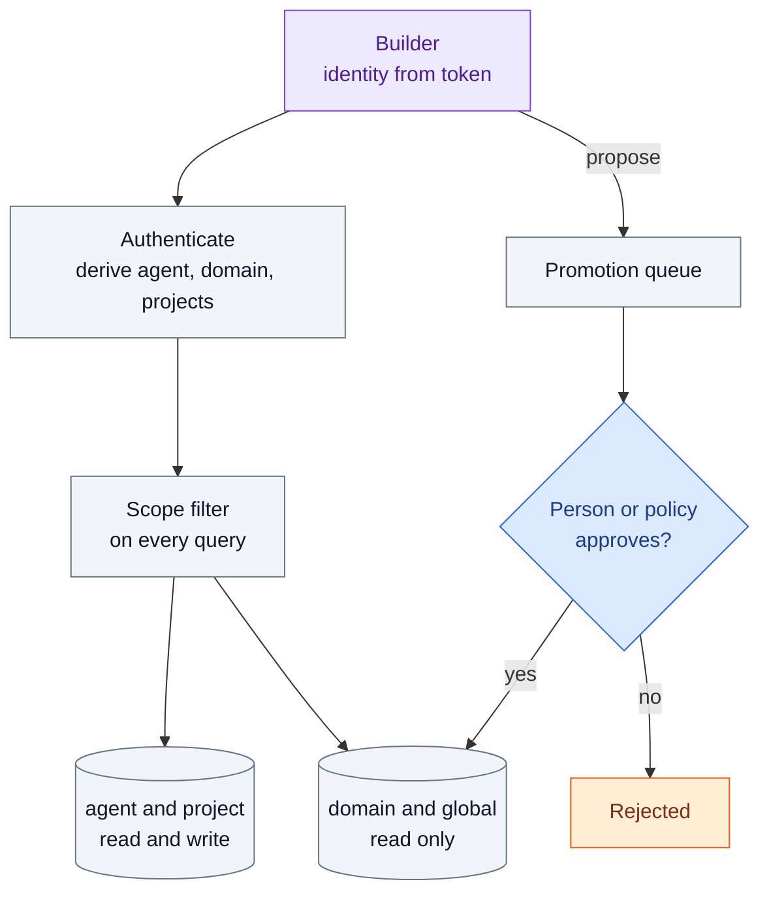

# Scoped memory

> **In short:** memory without isolation is a shared whiteboard. Any agent can be tricked into
> reading from it or writing to it. Give each agent its own part, and guard the shared parts.

## The problem

Agents read text and act on it. If every agent can write to one shared memory, one bad entry
spreads to every future run. The entry can come from a confused agent or from a prompt hidden in
an issue.

Identity is the other weak spot. If the memory service trusts an `agent_id` the caller passes,
any agent can claim to be any other and read its notes.

## How it works

A [scope](../reference/glossary.md) is the part of memory an agent may read or write. The memory
service enforces scopes in five steps:

1. **Authenticate the caller.** The service takes the identity from the token or service
   account, never from a tool parameter.
2. **Work out the scopes.** From that identity it derives the agent, its domain and its projects.
3. **Filter every read.** One scope filter function runs on every query. No query skips it.
4. **Write only where allowed.** An agent writes freely to its own scope and to its project's
   scope. The domain and global scopes are read-only for it.
5. **Promote by proposal.** To share a learning wider, the agent proposes it. A person or a
   policy approves it into the shared scope.

| Scope | Who reads | Who writes |
|---|---|---|
| `agent` | That agent | That agent |
| `project` | Agents of one repository | Agents of that repository |
| `domain` | Agents of a group of projects | Only by promotion |
| `global` | Every agent | Only by promotion |

The diagram shows a read and a proposal going through the service.

Each entry also carries where it came from (the run id), how sure the agent was, and how long it
stays valid. When an entry turns out to be wrong, you invalidate it, and briefings stop using it.

## Example

While fixing Ana's bug, the builder learns that spreadsheet apps need a BOM to show accents. It
saves that in the `project` scope of the reports repository, tagged with its run id.

The fact applies to every team that exports CSV. So the builder proposes it for the `domain`
scope. A person approves it. Now the builder of another repository gets it in its briefing too.

> [!TIP]
> Test isolation directly. Write a test in which one agent tries to read another agent's scope,
> and check that it fails.

## Checklist

- **MC-07** The memory service MUST take the caller's identity from authentication (service
  account, token), never from a tool parameter.
- **MC-08** Every read MUST go through one scope filter function, and tests MUST try to read
  another scope and fail.
- **MC-09** Scopes SHOULD be `agent` (free writes), `project` (agents of one repository),
  `domain` (a group of projects) and `global` (read-only for agents).
- **MC-10** Writes to shared scopes MUST go through a proposal that a person or a policy promotes.
- **MC-11** Entries MUST carry provenance (run id), confidence and validity, and it MUST be
  possible to invalidate them when they prove wrong.
- **MC-12** The service SHOULD be stateless and offer its tools through a standard protocol (for
  example MCP), so any agent harness can use it.

## Sources

[S5] [R]

## Up

[07. Memory and context](README.md)
