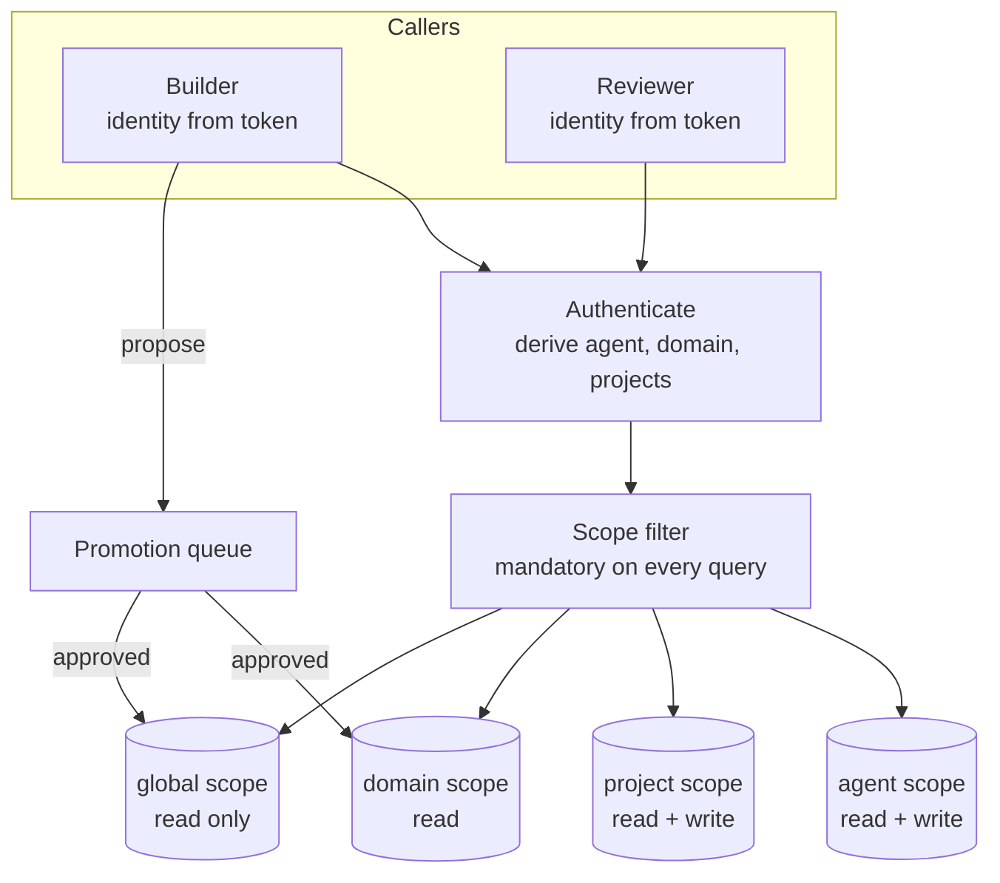

# Scoped memory

> Memory without isolation is a shared whiteboard that any agent can be tricked into reading or
> writing.

## Rules

- **MC-07** The memory service MUST derive the caller's identity from authentication (service
  account, token), never from a tool parameter.
- **MC-08** Every read MUST pass through one scope filter function; tests MUST try to read another
  scope and fail.
- **MC-09** Scopes SHOULD be: `agent` (free writes), `project` (agents of one repository),
  `domain` (a group of projects), `global` (read-only for agents).
- **MC-10** Writes to shared scopes MUST go through a proposal that a person or a policy promotes.
- **MC-11** Entries MUST carry provenance (run id), confidence and validity, and MUST be
  invalidatable when proved wrong.
- **MC-12** The service SHOULD be stateless and expose its tools through a standard protocol
  (for example MCP) so any agent harness can use it.

## Diagram

## Sources

[S5] [R]

## Up

[07. Memory and context](README.md)
