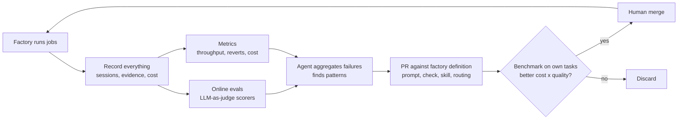

# 08. Self-improvement

> A factory that does not measure itself is running on vibes. A factory that measures itself can
> propose its own improvements.

## Rules

- **SI-01** The factory's definition (agents, prompts, models, triggers, tools, gate, policy) MUST
  be code in a repository, changed only through pull requests.
- **SI-02** Every session MUST be recorded: conversation, tool calls, diffs, evidence, cost,
  duration, outcome.
- **SI-03** A baseline of delivery metrics MUST be measured before the factory starts, and the same
  metrics MUST be tracked continuously.
- **SI-04** Quality MUST be measured with online evals on recorded sessions and with benchmarks
  built from the team's own past tasks, not with public benchmarks alone.
- **SI-05** Agents SHOULD aggregate failures into patterns and open pull requests against the
  factory definition; those PRs MUST be merged by people (protected paths).
- **SI-06** Goal-oriented work ("reduce p99", "keep parity") SHOULD start only after evals and
  metrics exist for the goal.

## Diagram

## Sources

[S1] [S4] [S5] [S8] [S10] [R]

## Go deeper

1. [Record everything](record-everything.md): sessions as the raw material.
2. [Metrics](metrics.md): what leadership and the factory itself should watch.
3. [Evals and benchmarks](evals-and-benchmarks.md): measuring quality on your own work.
4. [Factory-as-code](factory-as-code.md): versioning, A/B tests and rollback of the factory itself.

## Up

[Manifesto](../../README.md)
