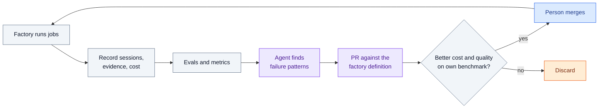

# 08. Self-improvement

> **In short:** a factory that doesn't measure itself runs on gut feeling. A factory that
> measures itself can propose its own improvements, and people decide which ones to merge.

## The problem

Most teams tune their agents by feel. Someone changes a prompt, the next few runs look better,
and the change stays. Nobody knows if it helped, or if it made another kind of job worse.

Without records, you can't even ask the question. The sessions are gone, the cost is a single
monthly bill, and the only quality signal is what reviewers remember.

## How it works

Self-improvement is a loop with a person at the merge:

1. **Define the factory in code.** Agents, prompts, models, triggers, tools, the gate and the
   merge policy live in a repository. You change them through pull requests.
2. **Record everything.** Every session keeps its conversation, tool calls, diffs, evidence,
   cost, duration and outcome.
3. **Measure.** Track delivery metrics from a baseline taken before the factory starts. Score
   sessions with online evals, which are small automatic checks on recorded sessions.
4. **Find patterns.** An agent groups failures by cause and proposes a fix to the factory: a
   prompt, a check, a skill or a routing change.
5. **Test the fix.** Replay your own past tasks with the change, and compare cost and quality.
6. **Merge by hand.** A person merges the pull request, because the factory definition is a
   [protected path](../reference/glossary.md).

The diagram shows the loop.

## Example

Ana's bug is fixed, but the review took two rounds. The recorded session shows why: the
builder never ran the scheduled export's tests before opening the PR. An eval that flags "PR opened without
running the module's tests" finds the same pattern in other jobs that week.

An improvement agent opens a PR that adds the export tests to the `reports` procedure in the
build prompt. Replayed on past tasks, it cuts review rounds without raising cost. A person
merges it.

> [!WARNING]
> **Chasing goals before you can measure them.** A goal like "reduce p99" or "keep parity" needs
> an eval and a metric first. Without them, the agent can't tell if it is getting closer.

## In this section

| Page | Read it to learn |
|---|---|
| [Record everything](record-everything.md) | What to keep from each session, and where |
| [Metrics](metrics.md) | What leadership and the factory itself should watch |
| [Evals and benchmarks](evals-and-benchmarks.md) | How to measure quality on your own work |
| [Factory-as-code](factory-as-code.md) | How to version, test and roll back the factory itself |

## Checklist

- **SI-01** The factory's definition (agents, prompts, models, triggers, tools, gate, policy) MUST
  be code in a repository, changed only through pull requests.
- **SI-02** Every session MUST be recorded: conversation, tool calls, diffs, evidence, cost,
  duration, outcome.
- **SI-03** A baseline of delivery metrics MUST be measured before the factory starts, and the
  same metrics MUST be tracked all the time after.
- **SI-04** Quality MUST be measured with online evals on recorded sessions and with benchmarks
  built from the team's own past tasks, not with public benchmarks alone.
- **SI-05** Agents SHOULD group failures into patterns and open pull requests against the factory
  definition, and people MUST merge those PRs (they touch protected paths).
- **SI-06** Goal-oriented work ("reduce p99", "keep parity") SHOULD start only after evals and
  metrics exist for the goal.

## Sources

[S1] [S4] [S5] [S8] [S10] [R]

## Up

[Manifesto](../../README.md)
