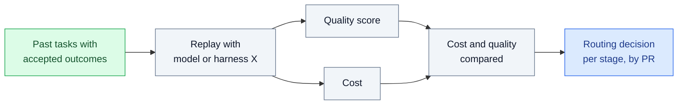

# Evals and benchmarks

> **In short:** public benchmarks measure someone else's codebase. Build your own from your past
> tasks, and use it to decide which model runs each stage.

## The problem

Public benchmarks suffer from a streetlight effect. They measure what is easy to measure, not
your codebase [S5][S10]. A model that tops a leaderboard can still be the wrong choice for your
review stage.

Without your own evals, failures look random. In fact they often share a cause. One team scored
its sessions and found that a large share of failures came from one cause: agents didn't read
the repository's skills. They fixed that cause in the factory [S5].

## How it works

There are two tools, and they answer different questions.

**Online evals** ask "what went wrong in this session?"

1. Write narrow scorers. Each one detects one failure type, such as redundant tests, ignored
   repository skills, or a bug fixed without being reproduced. A scorer can be a script or an
   LLM acting as a judge.
2. Run them on recorded sessions. Every session can be scored, and the score is stored with it.

**A private benchmark** asks "would another model or harness do better here?"

1. Collect real past tasks with known good outcomes.
2. Replay them with the model or harness you want to try.
3. Compare quality and cost side by side.
4. Change routing (for example, a cheaper model for a narrow stage) only when the comparison
   justifies it, and do it through a PR.

The diagram shows the benchmark loop.

Domain agents, the small agents at the edges of the factory, need their own eval too. It should
measure the business outcome they own, such as alerts sorted correctly.

## Example

The "unreproduced bug fix" scorer reads the session for Ana's job. It finds a test that failed
before the fix and passes after, so the session scores well.

Later the team wants a cheaper model for triage. They replay a set of past triage tasks,
including Ana's, on the cheaper model. They compare the risk and kind it chose with the accepted
ones, and the cost. The numbers decide the routing, not the leaderboard.

> [!NOTE]
> The sources disagree on cheap models. A tutorial found cheap reviewers counterproductive [S3].
> Domain-agent advocates favor cheap models for small tasks [S10]. Your own benchmark settles it
> for your stages.

## Checklist

- **SI-16** Online evals SHOULD be narrow scorers (LLM-as-judge or deterministic) that each
  detect one failure type, such as redundant tests, ignored repository skills or unreproduced bug
  fixes.
- **SI-17** Every session MUST be eligible for scoring, and scores MUST be stored with the
  session.
- **SI-18** A private benchmark MUST be built from real past tasks with known good outcomes.
- **SI-19** Model and harness changes (including routing cheaper models to narrow stages) MUST be
  justified by comparing cost and quality on that benchmark.
- **SI-20** Each domain agent MUST have its own eval that measures the business outcome it owns.

## Sources

[S3] [S5] [S8] [S10]

## Up

[08. Self-improvement](README.md)
