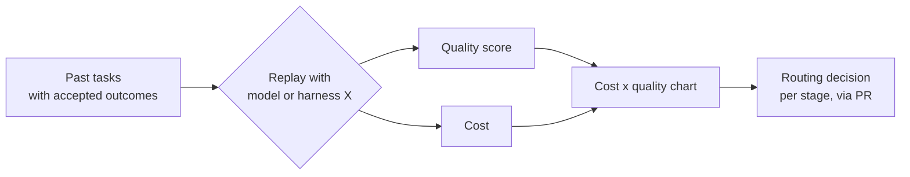

# Evals and benchmarks

> Public benchmarks measure someone else's codebase. Yours is the only one that matters.

## Rules

- **SI-16** Online evals SHOULD be narrow scorers (LLM-as-judge or deterministic) that each detect
  one failure type, for example redundant tests, ignored repository skills, unreproduced bug fixes.
- **SI-17** Every session MUST be eligible for scoring; scores MUST be stored with the session.
- **SI-18** A private benchmark MUST be built from real past tasks with known good outcomes.
- **SI-19** Model and harness changes (including routing cheaper models to narrow stages) MUST be
  justified by a cost × quality comparison on that benchmark.
- **SI-20** Domain agents MUST each have their own eval measuring the business outcome they own.

## Diagram

## Why

Public benchmarks suffer from a streetlight effect: they measure what is easy to measure, not your
codebase [S5][S10]. A team found by scoring sessions that a large share of failures came from one
cause, agents not reading the repository's skills, and fixed the cause in the factory [S5].

## Sources

[S5] [S8] [S10]

## Up

[08. Self-improvement](README.md)
