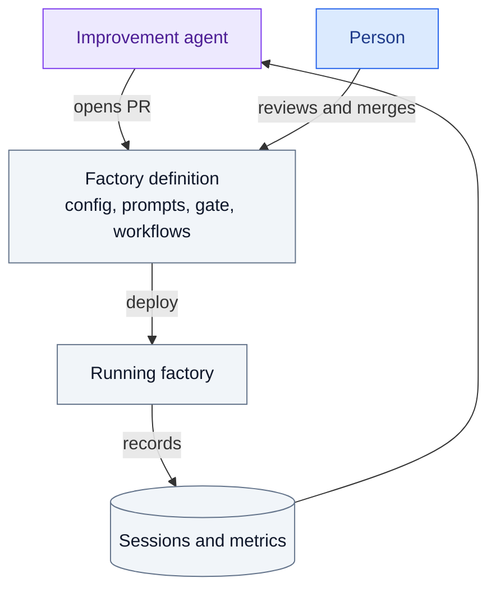

# Factory-as-code

> **In short:** the factory is a system, so engineer it like one. Declare it in files, version
> it, review changes, measure them, and roll them back with one revert.

## The problem

A factory set up by hand in dashboards and settings pages can't be reviewed. Nobody can see what
changed last Tuesday, or why the builder started using a different model. When a change makes
things worse, there is nothing to revert.

A factory that agents improve has a sharper version of this risk. If an agent can change the
gate or the merge policy without a person, it can switch off its own guardrails.

## How it works

[Factory-as-code](../reference/glossary.md) means the factory's definition lives in a versioned
repository and changes through pull requests.

1. **Declare everything in files.** Agents, prompts, the model per stage, triggers, tools and
   MCP servers, the execution engine per stage, the gate, the merge policy and budgets.
2. **Protect those files.** They are protected paths. Agents may propose changes. People merge
   them.
3. **Test changes side by side.** Try a change on a share of jobs (an A/B test), or replay the
   benchmark, before you roll it out to all jobs.
4. **Roll back with one revert.** Each factory change is one PR, so undoing it is one revert.
5. **Switch engines by configuration.** Moving a stage to another execution engine, for example
   from CI runners to a container service, is a config switch. You move one stage at a time and
   can switch back.

The diagram shows who changes the definition, and how changes reach the running factory.

A typical layout keeps a config file (models, engine per stage, budgets, merge policy), a
`prompts/` folder (triage, build, review), the gate script and the workflows, all in one
protected repository.

## Example

After Ana's bug, the improvement agent proposes a change to the build prompt: run the module's
tests before opening a PR. The change is one PR to the factory definition.

The team turns it on for half of the low-risk bugs for two weeks. Review rounds drop for that
half, so a person merges it for all jobs. If it had made things worse, they would have reverted
that one PR.

> [!IMPORTANT]
> The factory improves itself, but it never merges its own changes. See
> [deny rules and protected paths](../03-guardrails/deny-rules-and-protected-paths.md).

## Checklist

- **SI-21** The factory MUST be declared in files: agents, prompts, models per stage, triggers,
  tools and MCP servers, execution engine per stage, gate, merge policy, budgets.
- **SI-22** These files MUST be protected paths: agents may propose changes, and people merge
  them.
- **SI-23** Changes to the factory SHOULD be tested side by side (A/B on a share of jobs, or a
  benchmark replay) before full rollout.
- **SI-24** Rolling back a factory change MUST be a revert of one PR.
- **SI-25** Moving a stage between execution engines (for example from CI runners to a container
  service) MUST be a configuration switch, so it can be done stage by stage and reverted.

## Sources

[S4] [S5] [R]

## Up

[08. Self-improvement](README.md)
