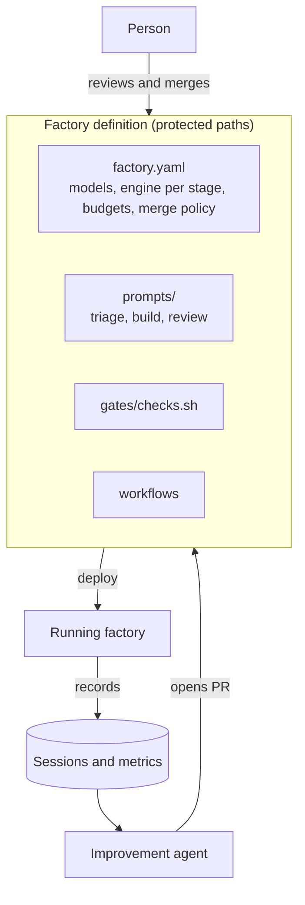

# Factory-as-code

> The factory is a system. Engineer it like one: declared, versioned, reviewed, measured.

## Rules

- **SI-21** The factory MUST be declared in files: agents, prompts, models per stage, triggers,
  tools and MCP servers, execution engine per stage, gate, merge policy, budgets.
- **SI-22** These files MUST be protected paths: agents may propose changes, people merge them.
- **SI-23** Changes to the factory SHOULD be testable side by side (A/B on a share of jobs or a
  benchmark replay) before full rollout.
- **SI-24** Rollback of a factory change MUST be a revert of one PR.
- **SI-25** Moving a stage between execution engines (for example from CI runners to a container
  service) MUST be a configuration switch, so it can be done stage by stage and reverted.

## Diagram

## Sources

[S4] [S5] [R]

## Up

[08. Self-improvement](README.md)
