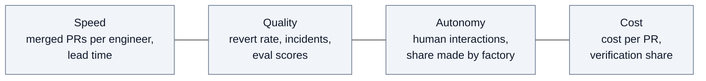

# Metrics

> **In short:** take a baseline before the factory starts, then track the same numbers every
> week. Without a baseline, a factory pilot becomes an opinion.

## The problem

After a month of agents, everyone has a view. Some say the team ships much more. Others say
the code got worse. Without numbers from before the factory, nobody can settle it.

Speed numbers alone mislead. A factory can raise merged PRs per week while it quietly fills the
repository with [slop](../reference/glossary.md): code that works today but makes the codebase
worse. That is why every speed number on this page has a quality number next to it.

## How it works

1. **Take a baseline first.** Measure the metrics below for the team before the factory builds
   anything for it.
2. **Track every week.** Split the numbers by risk and kind, so one kind's trouble doesn't hide
   behind another's success.
3. **Pair speed with quality.** Never report throughput without a quality metric next to it.
4. **Set budgets.** Daily and monthly cost limits stop new dispatches when they are reached.

| Metric | Why it matters |
|---|---|
| Merged PRs per engineer per week | Throughput that leadership understands |
| Share of merged PRs made by the factory | How much work moved to the factory |
| Revert rate and incidents per PR | Whether speed is producing slop |
| Lead time from request to production | The whole flow, not just coding |
| Human interactions per PR | How automated the work really is |
| Cost per PR, and the share spent on verification | Spend control, and whether checking is funded |
| Share of PRs with evidence | Whether review is moving to artifacts |
| Checks created from corrections | Whether the team turns fixes into guardrails |
| Eval scores by failure type | Input to the improvement loop |
| Jobs in `hold` and `failed` per week, by reason | Where the factory gets stuck |

The diagram groups the metrics into four families. Read them together, never one alone.

## Example

Ana's job shows up in this week's numbers as one merged `bug` of `risk:low`. It counts toward
merged PRs and lead time. Its two review rounds count toward human interactions. Its failing
test, now passing, counts toward PRs with evidence.

If the fix gets reverted next week, the revert rate for `bug` jobs goes up. That number, not a
feeling, decides whether low-risk bugs keep their current merge ceiling.

> [!WARNING]
> **Reporting throughput alone.** "PRs per week doubled" says nothing without the revert rate next
> to it. Always show speed and quality side by side.

## Checklist

- **SI-12** The baseline MUST be taken before the factory starts building for a team.
- **SI-13** The metrics above MUST be tracked every week, and SHOULD be split by risk and kind.
- **SI-14** Throughput MUST NOT be reported without a quality metric next to it.
- **SI-15** Budget limits (daily and monthly cost) MUST exist and MUST stop new dispatches when
  reached.

## Sources

[S1] [S2] [S4] [S5] [S8] [R]

## Up

[08. Self-improvement](README.md)
