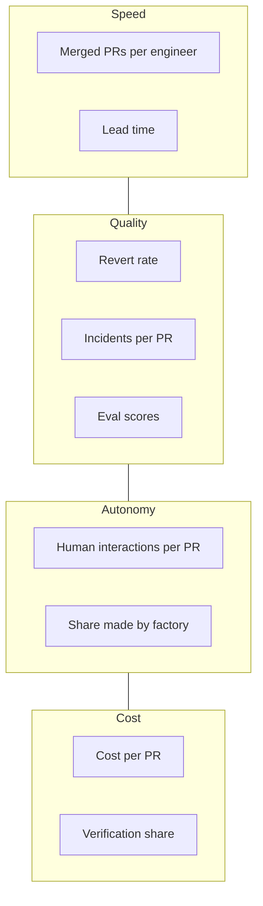

# Metrics

> Without a baseline, a factory pilot becomes an opinion.

## Rules

- **SI-12** The baseline MUST be taken before the factory starts building for a team.
- **SI-13** The metrics below MUST be tracked per week, and SHOULD be split by risk and kind.
- **SI-14** Throughput MUST NOT be reported without a quality metric next to it.
- **SI-15** Budget limits (daily and monthly cost) MUST exist and MUST stop new dispatches when
  reached.

## The metric set

| Metric | Why it matters |
|---|---|
| Merged PRs per engineer per week | Throughput leadership understands |
| Share of merged PRs made by the factory | How much work moved to the factory |
| Revert rate and incidents per PR | Whether speed is producing slop |
| Lead time from request to production | The whole flow, not just coding |
| Human interactions per PR | Real degree of automation |
| Cost per PR, and share of cost spent on verification | Spend control, and whether verification is funded |
| Share of PRs with evidence | Whether review is moving to artifacts |
| Checks created from corrections | Whether the team tends the garden |
| Eval scores by failure type | Input to the improvement loop |
| Jobs in `hold` and `failed` per week, by reason | Where the factory gets stuck |

## Diagram

## Sources

[S1] [S2] [S4] [S5] [S8] [R]

## Up

[08. Self-improvement](README.md)
