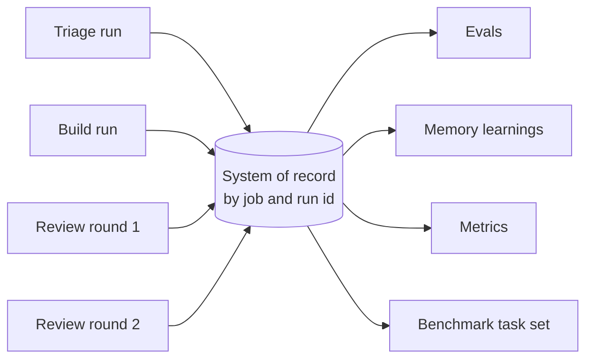

# Record everything

> You cannot improve what you did not keep.

## Rules

- **SI-07** Each run MUST store, linked to its job and run id: the conversation, tool calls and
  outputs, the diff, evidence artifacts, cost, duration and outcome.
- **SI-08** The record MUST be centralized (one system of record across agents and teams), not
  scattered across CI logs and laptops.
- **SI-09** Cost and duration MUST be attributed per stage (triage, build, each review round).
- **SI-10** Raw artifacts SHOULD expire on a schedule; summaries and learnings MAY be kept longer.
- **SI-11** Records MUST NOT contain secrets. Redaction MUST happen before storage.

## Diagram

## Sources

[S4] [S5] [S8] [R]

## Up

[08. Self-improvement](README.md)
