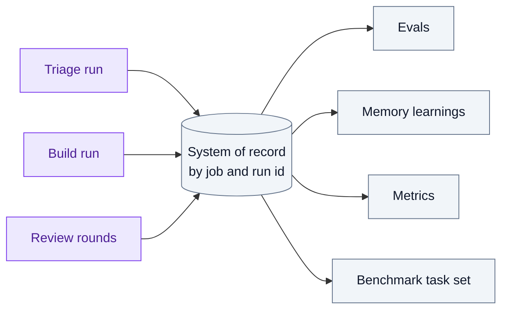

# Record everything

> **In short:** you can't improve what you didn't keep. Store every session in one place, linked
> to its job, and build evals, metrics and memory from it.

## The problem

A factory produces a lot of evidence about itself, and most of it disappears. CI logs expire.
Local sessions stay on laptops. Review comments are spread across pull requests. When a job goes
wrong, nobody can replay what the agent saw and did.

Cost has the same problem. One bill for the month can't tell you whether triage, the build or the
third review round is where the money goes.

## How it works

1. **Store each run.** Link it to its job and its run id. Keep the conversation, the tool calls
   and their outputs, the diff, the evidence, the cost, the duration and the outcome.
2. **Use one system of record.** Every agent and every team writes to the same place, not to CI
   logs and laptops.
3. **Split cost and time by stage.** Triage, build and each review round get their own numbers.
4. **Remove secrets first.** Redact them before anything is stored.
5. **Expire raw data on a schedule.** Keep summaries and learnings for longer.

The diagram shows each run feeding one store, and the store feeding everything else.

## Example

Ana's job has four records under one job id: triage, build, and two review rounds. Each has its
own cost and duration. The build record holds the failing test, the diff and the passing test
run on `factory/issue-412`.

Months later, someone wants a benchmark for encoding bugs. Ana's job is already there, with a
known good outcome. They add it to the task set.

> [!IMPORTANT]
> Records must never contain secrets. Redact tokens and keys before storage, not after. A secret
> in a session record is a leaked secret.

## Checklist

- **SI-07** Each run MUST store, linked to its job and run id: the conversation, tool calls and
  outputs, the diff, evidence artifacts, cost, duration and outcome.
- **SI-08** The record MUST be central (one system of record across agents and teams), not spread
  across CI logs and laptops.
- **SI-09** Cost and duration MUST be split by stage (triage, build, each review round).
- **SI-10** Raw artifacts SHOULD expire on a schedule. Summaries and learnings MAY be kept longer.
- **SI-11** Records MUST NOT contain secrets. Redaction MUST happen before storage.

## Sources

[S4] [S5] [S8] [R]

## Up

[08. Self-improvement](README.md)
