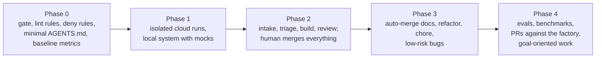

# 09. Adoption

> Guardrails and verification first, isolated environments second, end-to-end automation third,
> measured self-improvement last.

Every source that reports high volume got there after six to twelve months of investment in the
environment, not by switching on a smarter model [S1][S2][S9]. The order matters more than the
tools.

## Rules

- **AD-01** The build order MUST be: guardrails and gate → isolated environments → end-to-end
  pipeline with human merge → auto-merge for low-risk kinds → self-improvement loop.
- **AD-02** Autonomy MUST grow one step at a time, per kind and per repository, driven by metrics.
- **AD-03** The factory SHOULD build itself: once the spine exists, new factory features are
  requested through the factory, one small module at a time.
- **AD-04** Buy commodity parts (the coding agent, sandboxes, previews); build only the glue
  (intake, gate, job state, merge policy, metrics).
- **AD-05** Engineers MUST own outcomes (a product area, a metric), not a queue of tickets handed
  to agents.

## Diagram

## Sources

[S1] [S2] [S4] [S5] [S7] [S8] [S9] [R]

## Go deeper

1. [Build order](build-order.md): what each phase delivers and its exit criteria.
2. [Trust ladder](trust-ladder.md): read-only, then action, then ownership.
3. [Human roles](human-roles.md): what engineers do in a factory.
4. [Anti-patterns and disagreements](anti-patterns.md): what failed, and where sources disagree.

## Up

[Manifesto](../../README.md)
