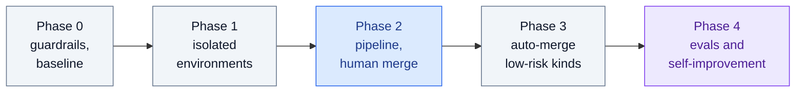

# 09. Adoption

> **In short:** build in this order: guardrails and verification, then isolated environments,
> then end-to-end automation, then measured self-improvement. The order matters more than the
> tools.

## The problem

It's tempting to start with the exciting part: a bot that takes a request and merges a PR. If
the code it produces is messy, automation just produces more messy code, faster [S2].

Every source that reports high volume got there after six to twelve months of work on the
environment, not by switching on a smarter model [S1][S2][S9].

## How it works

You adopt a factory in five phases. Each phase ends with exit criteria you measure before you
start the next one.

1. **Phase 0, guardrails.** The gate, lint rules, deny rules, a short `AGENTS.md` and baseline
   metrics.
2. **Phase 1, environments.** Isolated cloud runs, and the system runnable locally with mocks.
3. **Phase 2, pipeline.** Intake, triage, build and review run end to end. A person merges
   everything.
4. **Phase 3, earned autonomy.** Auto-merge for `docs`, `refactor`, `chore` and low-risk bugs.
5. **Phase 4, self-improvement.** Evals, benchmarks, PRs against the factory, and goal-oriented
   work.

Autonomy grows one step at a time, per kind and per repository, based on metrics. Once the
[deterministic spine](../reference/glossary.md) exists, the factory should build itself. You
request new factory features through the factory, one small module at a time.

The diagram shows the phases in order.

Two more choices shape adoption. **Buy the commodity parts**: the coding agent, sandboxes and
preview environments. **Build only the glue**: intake, the gate, job state, the merge policy and
metrics. And give engineers outcomes to own, such as a product area or a metric, instead of a
queue of tickets to hand to agents.

## Example

Ana's team is in phase 2. Her bug goes through triage, build and review on its own, and an
engineer merges the PR on `factory/issue-412`.

The same bug in phase 3 would merge automatically, because it is a `bug` of `risk:low`. The team
gets there only after the revert rate for low-risk bugs under human merge stays at or below the
baseline.

> [!WARNING]
> **A lights-off factory on day one.** Models that extend their own code without supervision
> degrade it steadily [S8]. Earn autonomy one kind at a time.

## In this section

| Page | Read it to learn |
|---|---|
| [Start your factory](build-order.md) | What each phase delivers, its exit criteria, and your first two weeks |
| [Trust ladder](trust-ladder.md) | How agents move from read-only to owning an outcome |
| [Human roles](human-roles.md) | What engineers do once a factory writes the code |
| [Anti-patterns and disagreements](anti-patterns.md) | What failed, and where the sources disagree |

## Checklist

- **AD-01** The build order MUST be: guardrails and gate, then isolated environments, then an
  end-to-end pipeline with human merge, then auto-merge for low-risk kinds, then the
  self-improvement loop.
- **AD-02** Autonomy MUST grow one step at a time, per kind and per repository, driven by
  metrics.
- **AD-03** The factory SHOULD build itself: once the spine exists, new factory features are
  requested through the factory, one small module at a time.
- **AD-04** You SHOULD buy commodity parts (the coding agent, sandboxes, previews) and build only
  the glue (intake, gate, job state, merge policy, metrics).
- **AD-05** Engineers MUST own outcomes (a product area, a metric), not a queue of tickets handed
  to agents.

## Sources

[S1] [S2] [S4] [S5] [S7] [S8] [S9] [R]

## Up

[Manifesto](../../README.md)
