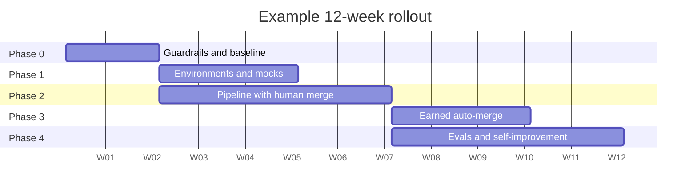

# Start your factory

> **In short:** build the factory in five phases, and don't start a phase until the previous one
> meets its exit criterion. If the inner loop produces slop, automating it only produces more
> slop.

## Before you start

You need three things before phase 0:

- **One pilot team** that opts in.
- **A baseline.** Measure that team's [delivery metrics](../08-self-improvement/metrics.md) now,
  before any agent builds for them. Every exit criterion below compares against it.
- **Someone who owns the factory.** See [human roles](human-roles.md).

## Phase 0: guardrails

Make bad changes hard to write before you automate anything.

1. Write one [gate](../05-verification/single-gate.md) script, and run it in hooks, in CI and in
   the factory.
2. Turn the most frequent review corrections into
   [lint rules that teach](../03-guardrails/teaching-lint-rules.md).
3. Version [deny rules](../03-guardrails/deny-rules-and-protected-paths.md) in the repository.
4. Trim `AGENTS.md` to [what the code can't show](../03-guardrails/minimal-agent-instructions.md).
5. Record the baseline.

**Exit criterion:** the gate runs in hooks, CI and the factory, and the baseline is recorded.

## Phase 1: environments

Give every run a safe place to work.

1. Make runs [disposable](../04-sandboxes/disposable-environments.md): each one starts clean and
   is thrown away.
2. Make the system [runnable with mocks](../04-sandboxes/local-with-mocks.md), so an agent can
   start it and test it.
3. Keep [secrets out of reach](../04-sandboxes/secrets-and-network.md) of the agent.

**Exit criterion:** a pilot service runs fully in a sandbox.

## Phase 2: pipeline

Connect the stages end to end. A person still merges every PR.

1. Add [intake](../01-work-intake/README.md) and triage, with an opt-in label for the pilot team.
2. Add the builder, and an [independent reviewer](../05-verification/independent-reviewer.md).
3. Track each request in a [job state machine](../02-deterministic-spine/job-state-machine.md).
4. Record memory for every run, as described in
   [briefing and reflection](../07-memory-and-context/briefing-and-reflection.md).

**Exit criterion:** most opted-in requests reach a reviewable PR.

## Phase 3: earned autonomy

Let the factory merge where the numbers say it's safe.

1. Turn on auto-merge for low-risk `docs`, `refactor`, `chore` and `bug` jobs, one kind at a
   time. See [risk times kind](../06-merge-policy/risk-times-kind.md).
2. Before you enable a kind, check its revert and incident rates under human merge. They must be
   at or below the baseline.

**Exit criterion:** revert and incident rates hold for a month.

## Phase 4: self-improvement

Let the factory propose changes to itself.

1. [Record every session](../08-self-improvement/record-everything.md).
2. Score sessions with [evals](../08-self-improvement/evals-and-benchmarks.md), and build a
   benchmark from your own tasks.
3. Let agents open PRs against the [factory definition](../08-self-improvement/factory-as-code.md).
   People merge them.
4. Start goal-oriented work only when evals and metrics exist for the goal.

**Exit criterion:** factory PRs improve eval scores or cost on the benchmark.

## How long it takes

The chart shows an example 12-week rollout. Phases 1 and 2 overlap, and so do phases 3 and 4.
Your timing will differ. The exit criteria matter, not the dates.

## Your first two weeks

By the end of week two, you should have the items below. The last two reach ahead into phase 2,
so the first real runs are tracked from day one.

- [ ] Baseline metrics for the pilot team.
- [ ] A trimmed instructions file.
- [ ] The single gate.
- [ ] Lint rules for the top five recurring corrections.
- [ ] Versioned deny rules.
- [ ] The run environment definition.
- [ ] The opt-in label and flow for one team.
- [ ] Memory recording for every run.

## Example

Ana's team is the pilot. In phase 0, the team notices that encoding mistakes come back in
review, so a lint rule for CSV writes is one of the first five. In phase 2, Ana's bug is one of
the first requests to reach a reviewable PR, on `factory/issue-412`. An engineer merges it.

The team wants auto-merge for low-risk bugs. They wait until the revert rate for those bugs,
under human merge, is at or below the baseline. Then they turn it on for `bug` only.

> [!WARNING]
> **Automating a loop you wouldn't merge by hand.** If agents' PRs need heavy rework today, a
> pipeline won't fix that. It will just deliver the rework faster. Finish phase 0 first.

> [!TIP]
> Use the factory to build the factory. Once phase 2 works, request new factory features through
> it, one small module at a time.

## Checklist

- **AD-06** Each phase MUST have exit criteria, measured against the baseline, that are met before
  the next phase starts.
- **AD-07** Auto-merge MUST NOT be turned on for any kind until that kind's revert and incident
  rates, under human merge, are at or below the baseline.
- **AD-08** The first two weeks SHOULD produce baseline metrics, a trimmed instructions file, the
  single gate and lint rules for the top five recurring corrections. They SHOULD also produce
  versioned deny rules, the run environment definition, the opt-in label and flow for one team,
  and memory recording for every run.

## Sources

[S2] [S7] [S8] [R]

## Up

[09. Adoption](README.md)
