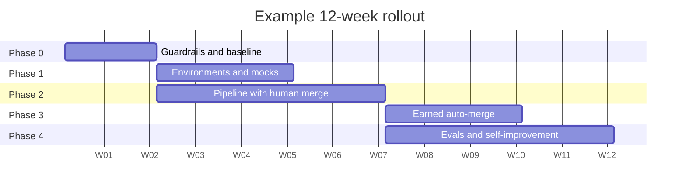

# Build order

> If the inner loop produces slop, automating it only produces more slop.

## Rules

- **AD-06** Each phase MUST have exit criteria measured against the baseline before the next
  phase starts.
- **AD-07** Auto-merge MUST NOT be enabled for any kind until the revert and incident rates for
  that kind, under human merge, are at or below baseline.
- **AD-08** The first two weeks SHOULD produce: baseline metrics, a trimmed instructions file, the
  single gate, lint rules for the top five recurring corrections, versioned deny rules, the run
  environment definition, the opt-in label and flow for one team, memory recording for every run.

## Phases and exit criteria

| Phase | Delivers | Exit criterion |
|---|---|---|
| 0. Guardrails | Gate, lint rules from corrections, deny rules, minimal instructions, baseline | Gate runs in hooks, CI and factory; baseline recorded |
| 1. Environments | Disposable runs, system runnable with mocks, secrets out of reach | A pilot service runs fully in a sandbox |
| 2. Pipeline | Intake, triage, build, independent review, human merge, job state | Most opted-in requests reach a reviewable PR |
| 3. Earned autonomy | Auto-merge for low-risk docs, refactor, chore, bug | Revert and incident rates hold for a month |
| 4. Self-improvement | Session records, evals, own benchmark, PRs against the factory, goal-oriented work | Factory PRs improve eval scores or cost on the benchmark |

## Diagram

## Sources

[S2] [S7] [S8] [R]

## Up

[09. Adoption](README.md)
