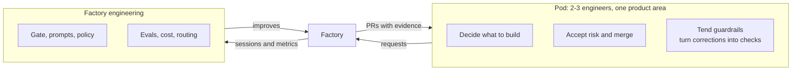

# Human roles

> When execution is cheap, deciding what to build is the scarce skill.

## Rules

- **AD-13** Teams SHOULD be small pods (two or three engineers) with vertical ownership of a
  product area: bug intake, QA, product decisions and their own board.
- **AD-14** Engineers MUST own outcomes (a metric, a user flow), not the act of passing tickets to
  agents.
- **AD-15** Someone MUST own the factory itself ("factory engineering"): guardrails, gate, prompts,
  evals, cost.
- **AD-16** People MUST keep the decisions the policy reserves for them: product direction, risk
  acceptance, protected paths, incident merges, infrastructure applies.
- **AD-17** Alignment SHOULD use visuals (diagrams, mockups, videos) rather than walls of text.

## Diagram

## Sources

[S1] [S4] [S8] [S9]

## Up

[09. Adoption](README.md)
