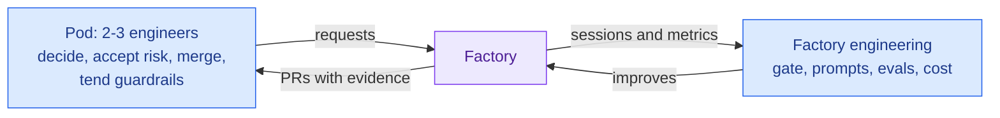

# Human roles

> **In short:** when writing code is cheap, deciding what to build becomes the scarce skill.
> Engineers own outcomes, and someone owns the factory itself.

## The problem

The first instinct is to keep the old team shape and add agents to it. Engineers become
dispatchers who pass tickets to a bot and review what comes back. The work gets faster, but
nobody owns whether it was the right work.

The factory itself also needs an owner. Without one, the gate rots, prompts drift and cost
climbs, and every team assumes someone else is watching.

## How it works

1. **Form small pods.** Two or three engineers own one product area end to end: bug intake, QA,
   product decisions and their own board.
2. **Own outcomes, not tickets.** Each engineer owns a metric or a user flow. Sending requests to
   the factory is a means, not the job.
3. **Staff factory engineering.** Someone owns the guardrails, the gate, the prompts, the evals
   and the cost.
4. **Keep the reserved decisions.** People decide product direction, accept risk, merge protected
   paths and incident fixes, and apply infrastructure changes.
5. **Align with visuals.** Use diagrams, mockups and videos instead of walls of text.

The diagram shows how pods and factory engineering share the factory.

## Example

Ana works in the reports pod. One engineer in the pod owns the metric "exports that open
correctly in spreadsheet apps". When Ana's bug comes in, that engineer reviews the evidence and
merges the PR. Then they ask a bigger question: which other exports could have the same problem?

Meanwhile, the factory engineer notices that review rounds for `reports` jobs are high. They
look at the sessions and change the build prompt, as described in
[factory-as-code](../08-self-improvement/factory-as-code.md).

> [!WARNING]
> **Engineers as ticket dispatchers.** If an engineer's job is to forward tickets to agents, the
> factory gets faster at work nobody chose on purpose. Give each engineer an outcome to own.

## Checklist

- **AD-13** Teams SHOULD be small pods (two or three engineers) that own a product area end to
  end: bug intake, QA, product decisions and their own board.
- **AD-14** Engineers MUST own outcomes (a metric, a user flow), not the act of passing tickets
  to agents.
- **AD-15** Someone MUST own the factory itself ("factory engineering"): guardrails, gate,
  prompts, evals, cost.
- **AD-16** People MUST keep the decisions the policy reserves for them: product direction, risk
  acceptance, protected paths, incident merges, infrastructure applies.
- **AD-17** Alignment SHOULD use visuals (diagrams, mockups, videos) rather than walls of text.

## Sources

[S1] [S4] [S8] [S9]

## Up

[09. Adoption](README.md)
