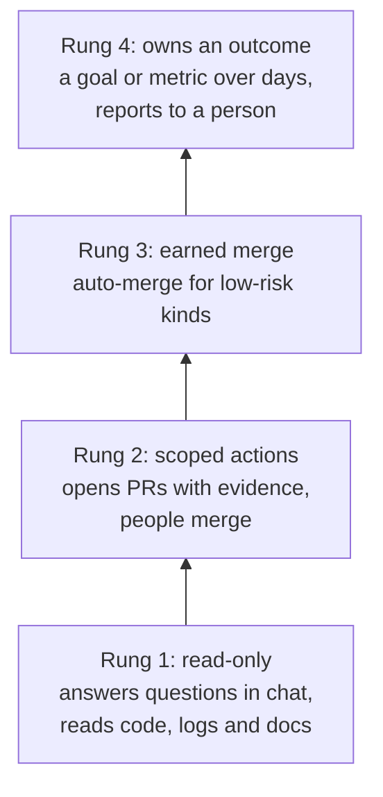

# Trust ladder

> Treat an agent like a new colleague: it starts by answering questions, then does small things
> you can check, then owns something.

## Rules

- **AD-09** A new agent or a new repository MUST start at the read-only rung.
- **AD-10** Moving up a rung MUST be a deliberate, recorded decision based on metrics, not a
  default that happens with time.
- **AD-11** Each rung MUST be reversible: a person can move an agent or a kind back down at once.
- **AD-12** Agents SHOULD have a visible identity (name, account) and appear where the team works,
  so people know who did what.

## Diagram

## Sources

[S1] [S9] [S10]

## Up

[09. Adoption](README.md)
