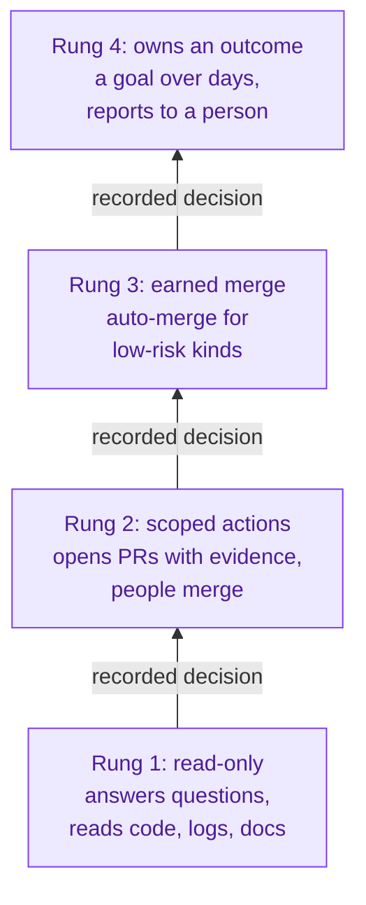

# Trust ladder

> **In short:** treat an agent like a new colleague. It starts by answering questions, then does
> small things you can check, then owns something.

## The problem

Teams tend to give an agent either too little trust or too much. Too little, and it stays a chat
toy that nobody relies on. Too much, and one bad day causes real damage.

The bigger risk is trust that grows by default. Nobody decides to let the bot merge. It just
starts happening because nothing went wrong last month.

## How it works

Trust grows on a ladder with four rungs, like a new hire's [S9]:

1. **Read-only.** The agent answers questions in chat, and reads code, logs and docs.
2. **Scoped actions.** The agent opens PRs with evidence. People merge them.
3. **Earned merge.** The agent's PRs auto-merge for low-risk kinds.
4. **Owns an outcome.** The agent works toward a goal or metric over days, and reports to a
   person.

Three rules keep the ladder honest:

- Every new agent and every new repository starts on rung 1.
- Moving up is a decision someone makes and records, based on metrics.
- Moving down is always possible, at once, for one agent or one kind.

Give each agent a visible identity too, with a name and an account. It should appear where the
team already works, so people know who did what.

The diagram shows the rungs, from bottom to top.

## Example

When the factory joins Ana's team, it starts on rung 1. Ana asks it in chat why the CSV export
loses accents, and it points to the file that writes without a BOM.

A month later the team records a decision: the factory moves to rung 2 for the reports
repository. Now Ana's bug becomes a PR on `factory/issue-412`, with a failing test that passes
after the fix. An engineer merges it. If low-risk bugs start getting reverted after a later
move to rung 3, the team moves `bug` back down to rung 2 the same day.

> [!WARNING]
> **Trust that grows with time alone.** "It's been fine for a month" isn't a decision. Move up
> only when the metrics say so, and write down who decided.

## Checklist

- **AD-09** A new agent or a new repository MUST start on the read-only rung.
- **AD-10** Moving up a rung MUST be a deliberate, recorded decision based on metrics, not a
  default that happens with time.
- **AD-11** Each rung MUST be reversible: a person can move an agent or a kind back down at once.
- **AD-12** Agents SHOULD have a visible identity (name, account) and appear where the team
  works, so people know who did what.

## Sources

[S1] [S9] [S10]

## Up

[09. Adoption](README.md)
