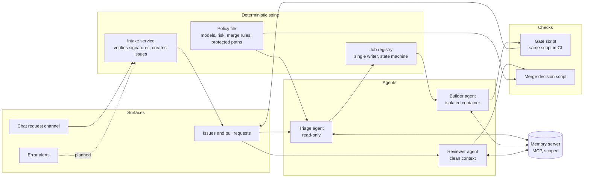

# Reference implementation

The practices in this manifesto are not theory for us. We run a factory built this way on our
own monorepo, and the factory builds most of itself. Internal identifiers are left out; the
shapes are the real ones.

## Components

| Practice | How we implement it |
|---|---|
| Intake where people already work | A small HTTP service receives chat mentions and slash commands, verifies the signature, creates an issue with a hidden marker linking back to the thread, and replies in the thread. |
| Read-only triage | A strong model reads the product spec and returns risk, kind, acceptance criteria, plan, affected paths, size and questions as JSON. A deterministic script applies that JSON to the issue. |
| Deterministic spine | Labels and workflow events move work. A job registry in a document database is written by exactly one CLI, which enforces the transition table. |
| Isolated builder | The builder runs as a container job with a token scoped to one repository, a turn limit and a wall-clock limit. |
| Single gate | One shell script runs lint, format, tests, monorepo guardrails and infrastructure validation. CI runs the same script. No PR is opened while it fails. |
| Independent reviewer | A separate agent with a clean context reviews every PR and applies an approve or changes label. Two returns go back to the builder; the third puts the job on hold. |
| Merge by risk and kind | A script decides. Auto-merge only for low risk, reviewer approval, no protected path, no hold and green CI on the latest commit. Medium risk needs one person, high needs two. |
| Scoped memory | An MCP server stores learnings, procedures, runs and spec chunks. The caller's identity comes from authentication, never from a tool argument, and every query is filtered by scope. |
| Factory-as-code | Prompts, models, gate and policy live in the repository under protected paths, so only people merge changes to the factory itself. |

## What we learned the hard way

- **Events raised by the CI token do not trigger other workflows** on our CI platform. The spine
  must dispatch the next stage explicitly instead of relying on a label event.
- **A gate that may be skipped will be skipped.** The builder prompt alone did not stop PRs with
  failing checks. Refusing to open the PR did.
- **A reviewer with no cap on returns can loop forever** on borderline findings. A fixed number of
  rounds followed by `hold` cost less than any smarter heuristic we tried.
- **Agents cannot change CI definitions** in our setup, on purpose. When a request needs that,
  the builder leaves the patch in a comment and a person applies it. The friction is intended.
- **Every stage must be idempotent** on the delivery id of the event that triggered it. Webhooks
  are redelivered, and a duplicated build costs real money.
- **A bug that cannot be reproduced must stop the job**, not produce a speculative fix. We send
  it to `hold` with a note and ask the requester for details.

## Up

[Manifesto](../../README.md)
